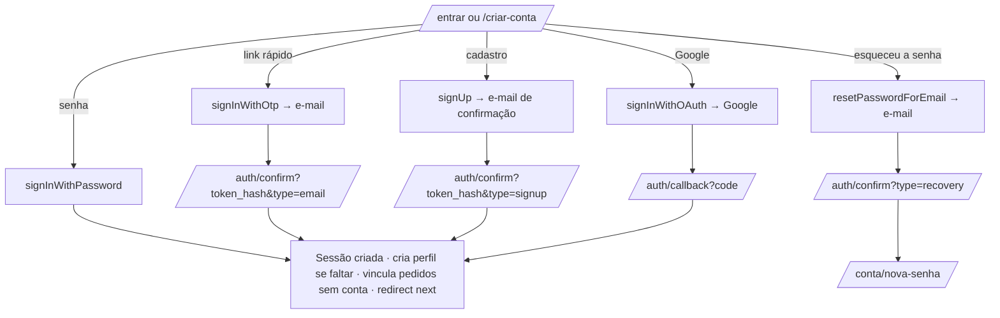

# Spec de implementação — Conta do cliente (login opcional)

> Status: **código pronto; falta a configuração ⚙️ do §6 e aplicar a migration** · 17/10/2026.
>
> A conta é **opcional**: quem não quiser logar continua comprando como hoje (sacola → `/carrinho` →
> InfinitePay → `/pedido/[id]`). O login só soma: dados preenchidos no checkout, todos os pedidos num lugar
> e acesso pelo Google.
>
> Convenções: **⚙️** = configuração fora do código (Supabase / Google Cloud), feita pela loja.
> **⏳** = pendência que não bloqueia o código.

## 0. Decisões tomadas

| Assunto | Decisão |
|---|---|
| Comprar sem conta | **Continua sendo o caminho padrão.** Nada no checkout exige login. |
| Provedor de login | **Supabase Auth**, o mesmo do painel. Clientes e admins ficam em `auth.users`; o `/admin` continua barrado por `ADMIN_EMAILS` (`src/server/auth.ts`). |
| Formas de entrar | **E-mail + senha**, **link rápido por e-mail** (magic link) e **Google**, como no layout de referência. |
| Cadastro | Resumo do cadastro da Vestem: **só CPF** (sem CNPJ/internacional), sem data de nascimento e sem Instagram. Endereço **opcional** no cadastro (é preenchido no 1º pedido). |
| Senha | Mínimo 8 caracteres, com letras e números (validado no site e configurado no Supabase ⚙️). |
| Confirmação de e-mail | **Ligada.** Cadastro com senha só entra depois de clicar no link do e-mail. Google já vem confirmado. |
| Onde ficam os dados | Tabela `customers` (1 linha por usuário, 1 endereço). RLS ligado **sem policies**: só o servidor (chave secreta) lê e grava, igual a `orders`. |
| Endereços | **Um** endereço salvo: o último usado num pedido ou o editado em `/conta`. Vários endereços fica para depois. |
| Header | O ícone de usuário leva para `/conta`; quem não estiver logado é mandado para `/entrar`. Sem JavaScript de login na home (ela continua estática). |
| Pedidos sem conta | Ao entrar, os pedidos **sem dono com o mesmo e-mail confirmado** passam para a conta. Nunca pelo CPF (qualquer um digita o CPF de outra pessoa). |
| Excluir conta | Botão em `/conta`. Apaga usuário e perfil; os pedidos ficam (obrigação fiscal), só perdem o vínculo. |

---

## 1. Telas

### 1.1 `/entrar` — Acessar conta (layout de referência)

Duas colunas no desktop, uma embaixo da outra no celular:

**Card "Acesse sua conta"**
- Texto: "Acompanhe pedidos, veja seus dados e compre com mais facilidade."
- Abas: **Com senha** | **Link rápido por e-mail**.
  - *Com senha*: E-mail, Senha (com botão de mostrar), link "Esqueceu a senha?", botão **Entrar na conta**.
  - *Link rápido*: E-mail, botão **Enviar link de acesso** → mensagem "Enviamos um link para …. Abra no mesmo aparelho."
- Divisor "ou continue com" + botão **Continuar com o Google**.

**Card "Criar uma nova conta"**
- Texto: "Cadastre-se para comprar mais rápido, salvar seu endereço e acompanhar seus pedidos."
- ✓ Checkout com seus dados já preenchidos · ✓ Acompanhamento do rastreio · ✓ Histórico de todos os pedidos
- Botão contorno **Criar minha conta** → `/criar-conta` (repassa o `?next=`).

Logado e abrindo `/entrar` → vai direto para `next` (ou `/conta`).

### 1.2 `/criar-conta` — Cadastro

Link no topo: "Já tem cadastro? Entre aqui". Um card com duas etapas numeradas (mesmo visual dos passos
do carrinho):

1. **Seus dados** — Nome completo\*, CPF\*, Celular/WhatsApp\*, E-mail\*, Senha\* ("mínimo 8 caracteres,
   com letras e números").
2. **Endereço de entrega (opcional)** — CEP (preenche pelo ViaCEP), Rua, Número, Complemento, Bairro,
   Cidade, UF. Se o CEP vier vazio, a etapa inteira é ignorada; se vier preenchido, valem as mesmas
   regras do checkout.

- Checkbox obrigatório: "Li e aceito a Política de Privacidade", com link para `/privacidade`
  (texto em `src/data/privacy.ts`).
- Botão **Criar conta**, alternativa **Continuar com o Google**.
- Sucesso → tela "Confirme seu e-mail: enviamos um link para …".

### 1.3 `/conta` — Minha conta (logado)

- "Olá, {primeiro nome}" + botão **Sair**.
- **Meus pedidos**: lista (data, nº curto, status, total) → cada item abre `/pedido/[id]`. Vazio: "Você
  ainda não tem pedidos" + link para a loja.
- **Meus dados**: Nome, CPF, Celular (editáveis) e E-mail (só leitura).
- **Endereço**: mesmos campos do checkout, editáveis.
- **Excluir minha conta** (pede confirmação digitando "EXCLUIR").

Sem login → `redirect('/entrar?next=/conta')`.

### 1.4 `/conta/nova-senha`

Chega pelo link de "Esqueceu a senha?". Campo nova senha + confirmar → salva e vai para `/conta`.

### 1.5 Checkout (`/carrinho`)

- No passo 1, sem login: linha "Já tem conta? **Entrar** para preencher seus dados" → `/entrar?next=/carrinho`.
- Logado: "Comprando como **{e-mail}**" e os campos vazios do formulário são preenchidos com o perfil
  (nome, CPF, celular, e-mail, endereço). O que o cliente já digitou não é sobrescrito.
- O resto do checkout não muda.

### 1.6 Header da loja

O ícone de usuário hoje abre o WhatsApp. Passa a ser um link para `/conta` com `aria-label="Minha conta"`.

---

## 2. Fluxos de autenticação



- `/auth/confirm` (route handler): com os templates padrão do Supabase recebe `?code=` e faz
  `exchangeCodeForSession` (link aberto no mesmo navegador); com os templates editados (exige SMTP próprio)
  recebe `?token_hash=&type=` e faz `verifyOtp`, que funciona em qualquer navegador.
- `/auth/callback` (route handler): `exchangeCodeForSession(code)` — só o Google usa.
- Os dois terminam em `finishLogin(user)` (§4) e redirecionam para `next`.
- **`next` só aceita caminho interno**: começa com `/` e não com `//` nem `/\`. Qualquer outra coisa vira
  `/conta` (evita *open redirect*).
- Erros voltam para `/entrar?erro=<código>` com mensagem amigável (link expirado, e-mail não confirmado,
  senha errada…). A mensagem de senha errada é sempre a mesma ("E-mail ou senha incorretos"), para não
  revelar quais e-mails têm conta.
- Cadastro com e-mail já existente: o Supabase não acusa (proteção contra enumeração). A tela mostra a
  mesma mensagem "Enviamos um link de confirmação para …".

---

## 3. Banco (migration `20261018000000_customers.sql`)

```sql
-- Perfil do cliente da loja (1 por usuário do Supabase Auth). Só o back-end lê e grava.
create table public.customers (
  id uuid primary key references auth.users on delete cascade,
  name text,
  cpf text,
  phone text,
  address jsonb,          -- mesmo formato de orders.shipping_address
  accepted_terms_at timestamptz,
  created_at timestamptz not null default now(),
  updated_at timestamptz not null default now()
);
alter table public.customers enable row level security;

-- Pedido ligado à conta (null = compra sem conta). Excluir a conta mantém o pedido.
alter table public.orders add column user_id uuid references auth.users on delete set null;
create index orders_user_id_idx on public.orders (user_id, created_at desc);
```

---

## 4. Código

| Arquivo | O que faz |
|---|---|
| `src/server/customers.ts` | `currentUser()` (via `authClient().auth.getUser()`), `getCustomer`, `saveCustomer`, `listCustomerOrders`, `finishLogin(user)` (cria o perfil se faltar + vincula pedidos), `safeNext(next)`. |
| `src/app/conta/actions.ts` | Server actions: `signInWithPassword`, `sendMagicLink`, `signInWithGoogle`, `signUp`, `requestPasswordReset`, `updatePassword`, `signOut`, `saveProfile`, `deleteAccount`. Cada uma valida os campos no servidor. |
| `src/app/auth/confirm/route.ts` | `verifyOtp` → `finishLogin` → redirect. `type=recovery` → `/conta/nova-senha`. |
| `src/app/auth/callback/route.ts` | `exchangeCodeForSession` → `finishLogin` → redirect. |
| `src/app/entrar/page.tsx`, `src/app/criar-conta/page.tsx`, `src/app/conta/page.tsx`, `src/app/conta/nova-senha/page.tsx` | Páginas (server) que leem a sessão e renderizam as views. |
| `src/views/Account/*` | Views client com styled-components (cards, abas, campos), no visual do carrinho. |
| `src/app/api/conta/route.ts` | `GET` → `{ email, name, cpf, phone, address }` ou `401`. Usado pelo carrinho para preencher o formulário (o `/carrinho` é estático, não lê cookies). |
| `src/app/api/checkout/route.ts` | Lê o usuário da sessão; se houver, grava `orders.user_id` e atualiza o perfil (nome, celular, endereço; CPF só se estava vazio). **O `user_id` nunca vem do corpo da requisição.** |
| `src/proxy.ts` | `matcher` passa a incluir `/entrar`, `/criar-conta`, `/conta/:path*` e `/auth/:path*` (renova a sessão). |
| `Header.tsx`, `CartPage.tsx` | Ícone → `/conta`; linha de login e preenchimento no passo 1. |

**Vincular pedidos sem conta** (`finishLogin`), só se `user.email_confirmed_at` existir:

```sql
update orders set user_id = :uid
where user_id is null and lower(customer->>'email') = lower(:email)
```

**Excluir conta**: `db().auth.admin.deleteUser(uid)` (o perfil sai em cascata e `orders.user_id` vira null)
e `signOut`.

---

## 5. Segurança

- No servidor, sempre `auth.getUser()` (valida o token no Supabase), nunca `getSession()`.
- Toda server action é um endpoint público: cada uma confere o login sozinha, como as do painel.
- Cliente logado não entra no `/admin` (a lista `ADMIN_EMAILS` continua valendo).
- Tentativas de login e envio de e-mails: limites do próprio Supabase Auth ⚙️ (Authentication → Rate Limits).
- `customers` e `orders` sem policies: o navegador nunca lê essas tabelas direto.

---

## 6. Configuração ⚙️ (a loja faz)

1. **Google Cloud Console** → APIs e serviços → Credenciais → *Criar ID do cliente OAuth* (Aplicativo da
   Web). URI de redirecionamento autorizado: `https://<projeto>.supabase.co/auth/v1/callback`. Tela de
   consentimento com nome, logo e e-mail da Blessfit.
2. **Supabase → Authentication → Sign In / Providers → Google**: colar Client ID e Client Secret.
3. **Supabase → Authentication → URL Configuration**: *Site URL* = domínio de produção; *Redirect URLs*:
   produção, HML (`https://*-<time>.vercel.app/**`) e `http://localhost:3000/**`.
4. **Supabase → Authentication → Email**: "Confirm email" ligado; senha mínima 8 com letras e números.
5. **Templates de e-mail: opcional, só depois do SMTP próprio** (o Supabase não deixa editar os templates
   sem SMTP). Com os templates padrão o login já funciona: o link passa pelo Supabase e volta para
   `/auth/confirm?code=…`, mas precisa ser aberto **no mesmo navegador** em que o cliente pediu o e-mail.
   Editando os templates, o link funciona em qualquer navegador. Trocar o `href` do link de cada um. O site manda
   `redirectTo` = `<site>/auth/confirm?next=…`, então o mesmo template serve para produção, HML e localhost
   (desde que a URL esteja nas *Redirect URLs* do passo 3; senão o Supabase troca pelo *Site URL* e o link quebra):
   - *Confirm signup*: `{{ .RedirectTo }}&token_hash={{ .TokenHash }}&type=signup`
   - *Magic Link*: `{{ .RedirectTo }}&token_hash={{ .TokenHash }}&type=email`
   - *Reset Password*: `{{ .RedirectTo }}&token_hash={{ .TokenHash }}&type=recovery`
6. **SMTP próprio** (⏳ antes de abrir para o público): o e-mail padrão do Supabase manda só ~2 e-mails
   por hora. Usar Resend (grátis até 3.000/mês) em Authentication → SMTP Settings, com remetente
   `nao-responda@<domínio>`. Até lá, o Google funciona normalmente.
7. Aplicar a migration no banco de HML e depois no de produção. Sem ela, a compra sem conta continua
   funcionando (o checkout só grava `user_id` com alguém logado), mas o login e `/conta` dão erro.

---

## 7. Fora do escopo (depois)

Vários endereços, lista de desejos, newsletter, login pelo celular (SMS/WhatsApp), CNPJ/compra
internacional, programa de fidelidade.

## 8. Testes

- `safeNext`: aceita `/carrinho`, `/conta?x=1`; recusa `https://x.com`, `//x.com`, `/\x.com`, vazio.
- Validação do cadastro (nome com sobrenome, CPF, celular, e-mail, senha 8+ com letra e número).
- Manual: cadastro → e-mail → confirmar → `/conta`; link rápido; Google; esqueci a senha; checkout logado
  grava `user_id` e preenche os campos; pedido feito sem conta aparece depois do login com o mesmo e-mail;
  cliente logado em `/admin` → barrado; excluir conta mantém o pedido no painel.
