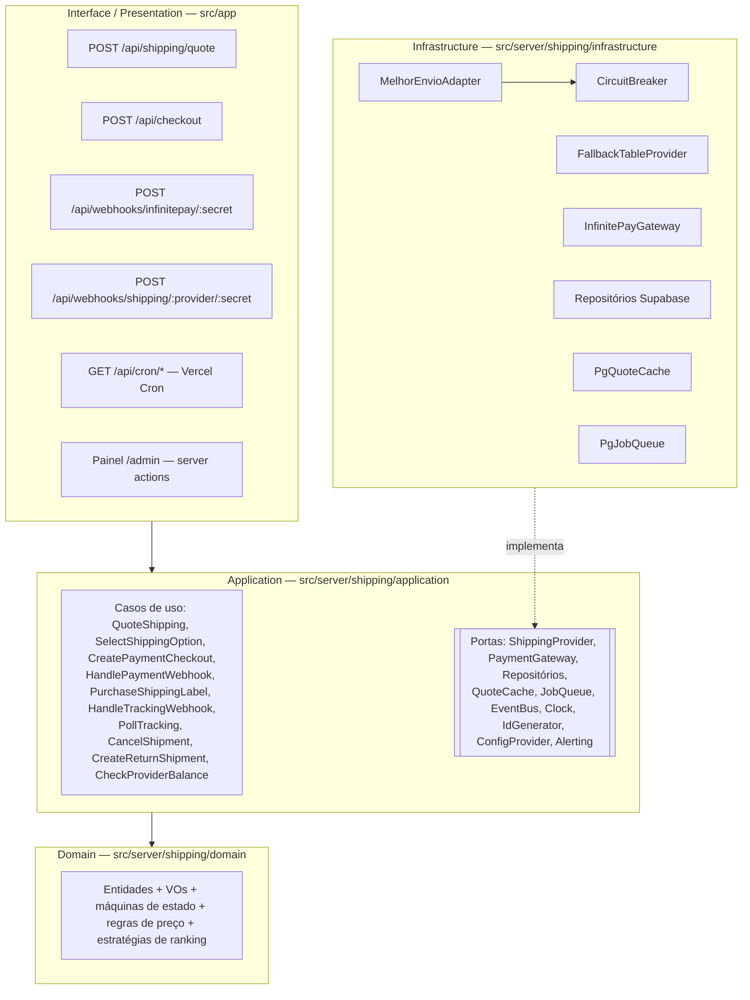
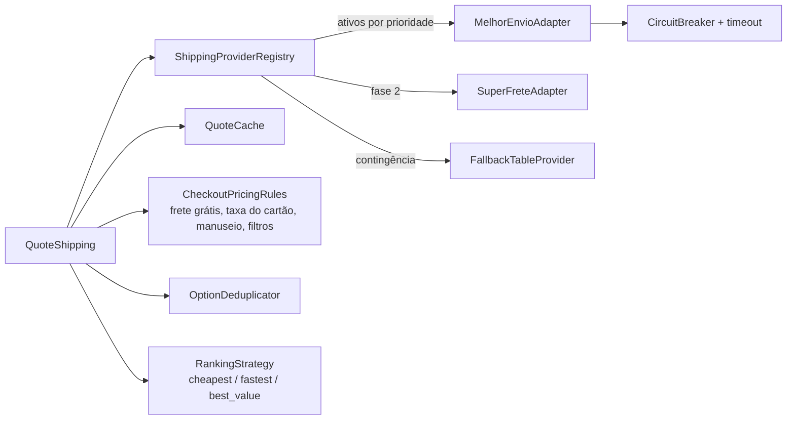
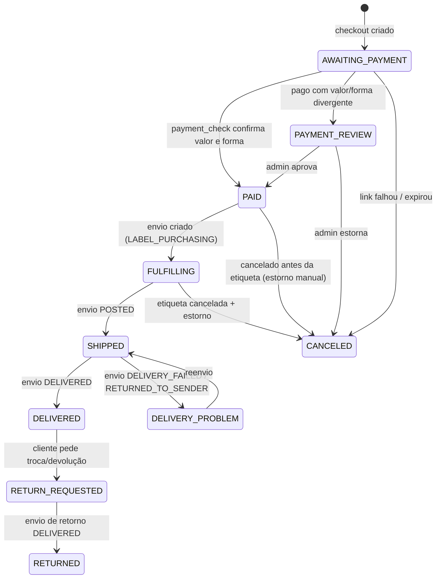
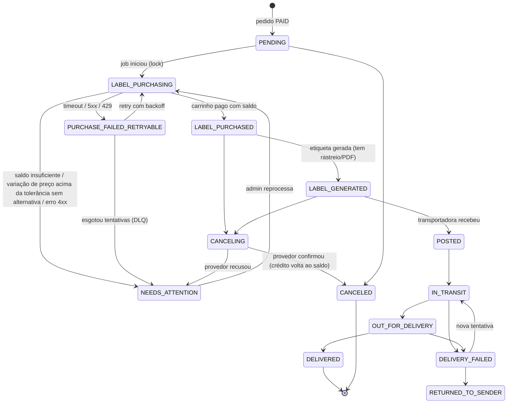

# Spec de implementação — Frete v2 (escala: fila, vários provedores, etiqueta automática)

> Status: **guardada para o futuro** · escrita em 15/10/2026, arquivada em 17/10/2026.
>
> A versão em uso é a enxuta, em [`spec-frete.md`](./spec-frete.md) (pensada para até ~50 pedidos/mês).
> Esta v2 só vale a pena quando aparecer pelo menos um destes sinais:
> - mais de ~300 pedidos/mês (≈ 10+/dia), e gerar etiqueta à mão passa a tomar tempo;
> - entrar um 2º provedor (SuperFrete, Frenet, contrato direto com Correios);
> - mais de um centro de distribuição despachando ao mesmo tempo;
> - pedidos pagos ficando sem etiqueta por esquecimento ou falha não percebida.
>
> As respostas já dadas em 17/10/2026 (ME com NF-e, CPF obrigatório, conta do Melhor Envio em análise, peso e
> medidas provisórios) estão na spec enxuta e valem também aqui.
>
> Convenção: tudo marcado com **🔎 VERIFICAR NA DOCUMENTAÇÃO OFICIAL (docs.melhorenvio.com.br)** é
> endpoint, campo ou limite que precisa ser confirmado antes de implementar. Nada aqui deve ser copiado
> para o código sem essa conferência.

## 0. Adaptação à stack real

O prompt original citava NestJS + Redis + BullMQ como exemplo. A loja hoje roda assim (e a spec segue isso):

| Necessidade | Exemplo do prompt | O que esta spec usa | Por quê |
|---|---|---|---|
| Runtime | NestJS | **Next.js 16 (App Router) na Vercel**, rotas em `src/app/api/*` | É o que existe; evita um 2º serviço |
| Banco | PostgreSQL | **Supabase Postgres** (já em uso; RLS ligado, só o back-end com chave secreta escreve) | Idem |
| Fila | BullMQ (Redis) | **Fila no Postgres**: tabela `jobs` + `FOR UPDATE SKIP LOCKED`, drenada por `after()` do Next e por **Vercel Cron** (varredura) | 50–1.000 pedidos/mês não justificam Redis. A porta `JobQueue` permite trocar por Vercel Queues ou BullMQ depois |
| Cache | Redis | **Tabela `shipping_quote_cache`** (Postgres, com `expires_at`) atrás da porta `QuoteCache` | Mesma razão; troca por Upstash/Runtime Cache sem tocar no domínio |
| Lock | Redis lock | **Postgres**: `UPDATE … WHERE status = X` condicional (padrão já usado em `confirmPayment`) e funções `plpgsql` com `SELECT … FOR UPDATE` | O supabase-js não abre transações; operações atômicas viram RPC |
| DI | Container do Nest | **Composition root** manual (`src/server/shipping/container.ts`) | Sem framework de DI; construtores recebem as portas |

Código que esta spec altera ou substitui:
- `src/server/orders.ts` (`confirmPayment`, `priceCart`) e `src/server/infinitepay.ts`.
- `src/app/api/checkout/route.ts`, `src/app/api/infinitepay-webhook/route.ts`, `src/app/api/order/route.ts`.
- `orders.status` (`pending | paid | review | shipped | delivered | canceled`) e o trigger `orders_log_status`.
- `SHOP.freeShippingFrom = 299` em `src/data/shop.ts` (vira configuração de regra de frete).

---

## 1. Visão geral e glossário

**Objetivo.** Cotar frete no checkout, cobrar o frete junto com os produtos na InfinitePay e, só depois do
pagamento confirmado, comprar e gerar a etiqueta automaticamente, acompanhar o rastreio e permitir
cancelamento e logística reversa. O Melhor Envio é o 1º provedor; trocar ou somar provedores = novo adaptador
+ configuração.

**Fora do escopo do MVP:** emissão de NF-e, coleta agendada, múltiplos volumes por pedido, split de pedido
entre centros de distribuição.

| Termo | Definição |
|---|---|
| **Provedor** (`ShippingProvider`) | Quem vende a etiqueta para a loja via API: Melhor Envio, SuperFrete, Frenet, Correios (contrato direto), Jadlog direto. Um provedor oferece vários serviços. |
| **Transportadora** (`Carrier`) | Quem transporta fisicamente: Correios, Jadlog, Loggi, J&T, Azul Cargo… Um mesmo serviço de transportadora pode vir de provedores diferentes. |
| **Serviço** (`ServiceLevel`) | Modalidade de uma transportadora: PAC, SEDEX, Mini Envios, .Package. Tem código canônico próprio (`CORREIOS_PAC`), independente do id do provedor. |
| **Cotação** (`ShippingQuote`) | Resultado de uma consulta: para um pacote, origem e destino, uma lista de `ShippingOption`. Tem validade. |
| **Opção** (`ShippingOption`) | Um serviço com preço de custo (etiqueta), preço cobrado do cliente, prazo e o provedor que o oferece. |
| **Snapshot de cotação** | Cópia **imutável** da opção escolhida, gravada no pedido no momento da escolha (preço de custo, preço cobrado, prazo, provedor, regras aplicadas, versão da config). É o que vale para cobrança e auditoria, mesmo que a tabela do provedor mude depois. |
| **Etiqueta** (`Label`) | Documento de postagem comprado do provedor. Tem número de rastreio e PDF. |
| **Envio** (`Shipment`) | Ciclo de vida físico de um pedido: compra da etiqueta → postagem → trânsito → entrega (ou falha/devolução). 1 pedido = 1 envio no MVP (+ envios de retorno). |
| **Centro de distribuição** (`Origin`) | Endereço de onde sai o pacote (Divinópolis/MG, Belo Horizonte/MG). |
| **Tabela de contingência** | Preço e prazo fixos por UF × faixa de peso, usados quando nenhum provedor responde. |

---

## 2. Diagramas de camadas e componentes

### 2.1 Camadas (dependências apontam só para dentro)



Regras de dependência (checadas por lint de import, ex. `no-restricted-imports` no oxlint):
- `domain/` não importa nada de fora de `domain/` (nem `next`, nem `@supabase`, nem `fetch`).
- `application/` importa só `domain/` e as interfaces em `application/ports/`.
- `infrastructure/` importa `application/ports` e `domain` (para mapear), nunca o contrário.
- `src/app/**` só chama casos de uso pelo `container.ts`. Nenhuma regra de negócio em rota.
- Todo arquivo em `src/server/**` mantém `import 'server-only'` (decisão da auditoria de 14/10/2026).

### 2.2 Estrutura de pastas proposta

```
src/server/
├── shipping/
│   ├── domain/            # entidades, VOs, state machines, pricing rules, ranking strategies, erros
│   ├── application/
│   │   ├── ports/         # ShippingProvider, PaymentGateway, repos, QuoteCache, JobQueue, Clock...
│   │   └── use-cases/     # um arquivo por caso de uso
│   ├── infrastructure/
│   │   ├── providers/melhor-envio/   # client HTTP, OAuth, mappers (ACL), service-map, webhook parser
│   │   ├── providers/fallback-table/
│   │   ├── payment/infinitepay/      # substitui src/server/infinitepay.ts
│   │   ├── persistence/supabase/
│   │   └── resilience/               # circuit breaker, retry, timeout
│   ├── config/            # schema + leitura única de env/config (ConfigProvider)
│   └── container.ts       # composition root
└── orders.ts              # passa a delegar para os casos de uso
```

### 2.3 Componentes de cotação



---

## 3. Modelo de domínio

Unidades canônicas do domínio: **dinheiro em centavos (inteiro)**, **peso em gramas (inteiro)**, **medidas em
milímetros (inteiro)**, **prazos em dias úteis (inteiro)**. Conversões (kg, cm, reais com decimais) só nos
adaptadores.

### 3.1 Value objects

| VO | Representação | Invariantes |
|---|---|---|
| `Money` | `{ cents: number }` (inteiro, BRL fixo) | `Number.isSafeInteger(cents)`; `cents >= 0` (descontos são operações, não valores negativos); arredondamento sempre explícito (`ceil` para preço cobrado, `round` para custo). Operações: `add`, `subtract` (falha se negativo), `multiplyRate(bps, rounding)`, `divideByOneMinus(bps, 'ceil')`. Taxas em **basis points** (`499` = 4,99%) para não usar float. |
| `Cep` | string de 8 dígitos | Só dígitos após normalizar (`30130-010` → `30130010`); 8 dígitos; não pode ser `00000000`. Expõe `prefix5()` e `uf()` (UF derivada por faixa de CEP — tabela no domínio). |
| `Weight` | `{ grams: number }` | Inteiro > 0; teto configurável (ex. 30.000 g). |
| `Dimensions` | `{ heightMm, widthMm, lengthMm }` | Inteiros > 0; `lengthMm >= widthMm` após normalização (ordena maior→menor para comparar com limites); expõe `cubicWeight(divisor)`. |
| `DeliveryWindow` | `{ minBusinessDays, maxBusinessDays }` | `0 <= min <= max`; `plus(handlingDays)` soma nos dois lados. |
| `ServiceCode` | string canônica (`CORREIOS_PAC`, `CORREIOS_SEDEX`, `CORREIOS_MINI`, `JADLOG_PACKAGE`, …) | Pertence ao catálogo canônico `ServiceCatalog` (domínio). Cada provedor mapeia seus ids para estes códigos. |
| `ProviderId` | `'melhor_envio' \| 'superfrete' \| 'correios_direct' \| 'fallback_table' \| …` | Registrado no registry. |
| `TrackingCode` | string | Não vazia; formato não validado no domínio (varia por transportadora). |

### 3.2 Entidades

**`Address`** — `{ recipientName, document?, phone?, email?, street, number, complement?, district, city, uf, cep: Cep }`
- Invariantes: `uf` coerente com `cep.uf()`; `number` obrigatório (aceita "S/N"); campos com tamanho máximo
  (definir a partir dos limites do provedor mais restritivo 🔎).
- Dado pessoal (LGPD): nunca vai para log; ver §12.

**`Package`** — `{ weight: Weight, dimensions: Dimensions, declaredValue: Money, items: PackageItem[] }`
- Montado a partir dos itens do pedido por um `PackagingPolicy` (domínio) que usa peso/medidas por produto
  (novas colunas em `products` ou catálogo) e caixas/envelopes configurados.
- Invariantes: peso ≥ soma dos itens + embalagem; `declaredValue` = soma dos itens (sem frete) salvo decisão
  contrária (§17).

**`Origin`** — `{ id, name, address: Address, active, handlingDays, cutoffTime }` (centro de distribuição).

**`ShippingOption`**
```
{ id, providerId, providerServiceRef, carrier, serviceCode,
  costPrice: Money,          // quanto a loja paga na etiqueta
  chargedPrice: Money,       // quanto o cliente paga (após regras)
  deliveryWindow: DeliveryWindow,   // já com dias de manuseio
  appliedRules: RuleTrace[], // ex.: [{rule:'card_fee', bps:499}, {rule:'free_shipping', id:'sudeste-299'}]
  constraints: { maxWeightG?, maxDimsMm?, maxDeclaredValue? },
  badges: ('cheapest'|'fastest'|'best_value')[] }
```
- Invariantes: `costPrice` e `deliveryWindow` presentes (opção sem preço ou prazo é descartada antes de virar
  entidade); `chargedPrice >= 0`; `badges` só atribuídos pela estratégia de ranking.

**`ShippingQuote`**
```
{ id, origin: OriginRef, destinationCep: Cep, package: Package,
  options: ShippingOption[], createdAt, expiresAt,
  source: 'live'|'cache'|'fallback', configVersion, providerResults: ProviderResultSummary[] }
```
- Invariantes: `expiresAt > createdAt`; `options.length <= 3` na versão exibida (a versão completa fica para
  relatório); imutável depois de criada.

**`QuoteSnapshot`** (value object gravado no pedido) — cópia congelada de `ShippingQuote` (id) +
`ShippingOption` escolhida + `expiresAt`. Imutável; qualquer alteração exige novo snapshot.

**`Order`** (agregado já existente, estendido)
```
{ id (= order_nsu), status: OrderStatus, method: 'card'|'pix',
  items, itemsTotal: Money, shippingCharged: Money, total: Money,
  shippingAddress: Address, quoteSnapshot: QuoteSnapshot | null,
  payment: { transactionNsu?, invoiceSlug?, paidAmount?, captureMethod?, installments? } }
```
- Invariantes: `total = itemsTotal + shippingCharged`; `quoteSnapshot` obrigatório para pedido com entrega
  (retirada local, se existir, é outro método — §17); não pode ir para `PAID` sem confirmação do
  `PaymentGateway`; `quoteSnapshot` não muda depois de `AWAITING_PAYMENT`.

**`Shipment`**
```
{ id, orderId, kind: 'outbound'|'return', status: ShipmentStatus,
  providerId, providerShipmentId?, serviceCode, origin, destination,
  package, quotedCost: Money, purchasedCost?: Money,
  trackingCode?, labelUrl?, attempts, lastError?, idempotencyKey }
```
- Invariantes: `idempotencyKey = orderId` (outbound) ou `orderId:return:n`; só 1 `outbound` ativo por pedido
  (garantido no banco, §9); `purchasedCost` definido a partir de `LABEL_PURCHASED`; `trackingCode`
  obrigatório a partir de `POSTED`.

**`TrackingEvent`** — `{ id, shipmentId, providerId, providerEventId?, status: ShipmentStatus, rawStatus,
occurredAt, receivedAt, description? }`
- Invariantes: deduplicado por `(shipmentId, providerId, providerEventId)` ou, sem id, por
  `(shipmentId, rawStatus, occurredAt)`; eventos fora de ordem são guardados mas só avançam o estado se a
  transição for válida (§4).

---

## 4. Máquinas de estado

Dois agregados com estados separados: o **pedido** (pagamento e visão do cliente) e o **envio** (logística).
O status do pedido em `shipped`/`delivered` é **derivado** dos eventos do envio.

### 4.1 Pedido



Mapeamento para os valores atuais de `orders.status` (migração sem quebrar o painel):

| Atual | Novo |
|---|---|
| `pending` | `AWAITING_PAYMENT` |
| `review` | `PAYMENT_REVIEW` |
| `paid` | `PAID` / `FULFILLING` |
| `shipped` | `SHIPPED` |
| `delivered` | `DELIVERED` |
| `canceled` | `CANCELED` |

Proposta: manter os valores em minúsculas no banco (`awaiting_payment`, …) com uma migration que converte os
antigos, e atualizar `src/app/admin/labels.ts` e o `StatusBadge`. Decisão em aberto (§17): renomear ou só
adicionar os novos.

### 4.2 Envio



Regras:
- A tabela de transições vive no domínio (`ShipmentStateMachine.canTransition(from, to)`), e é a mesma usada
  por webhook, polling e painel. Transição inválida → evento gravado em `tracking_events`, estado não muda,
  métrica `tracking_out_of_order_total`.
- Estados terminais: `DELIVERED`, `CANCELED`, `RETURNED_TO_SENDER` (este pode abrir um novo envio).
- Cancelamento só é permitido antes de `POSTED` (e dentro do prazo do provedor 🔎).

---

## 5. Contratos das portas

> Assinaturas apenas. `Result<T, E>` = união discriminada `{ ok: true, value } | { ok: false, error }`; erros
> esperados não são exceções.

### 5.1 `ShippingProvider`

```ts
interface ShippingProvider {
  readonly id: ProviderId
  readonly capabilities: ProviderCapabilities

  quote(req: QuoteRequest, ctx: CallContext): Promise<Result<ProviderQuote, ProviderError>>
  purchaseLabel(req: PurchaseLabelRequest, ctx: CallContext): Promise<Result<PurchasedLabel, ProviderError>>
  generateLabel(ref: ProviderShipmentRef, ctx: CallContext): Promise<Result<GeneratedLabel, ProviderError>>
  getLabelPdf(ref: ProviderShipmentRef, ctx: CallContext): Promise<Result<LabelDocument, ProviderError>>
  cancelLabel(ref: ProviderShipmentRef, reason: CancelReason, ctx: CallContext): Promise<Result<CancelResult, ProviderError>>
  getTracking(refs: ProviderShipmentRef[], ctx: CallContext): Promise<Result<TrackingSnapshot[], ProviderError>>
  parseWebhook(input: RawWebhook): Result<ParsedShippingWebhook, WebhookError>   // valida assinatura + mapeia
  getBalance(ctx: CallContext): Promise<Result<Money, ProviderError>>
  findByIdempotencyKey(key: string, ctx: CallContext): Promise<Result<ProviderShipmentRef | null, ProviderError>>
}

type ProviderCapabilities = {
  prepaidWallet: boolean          // Melhor Envio: true (paga com saldo)
  webhooks: boolean
  webhookSignature: 'hmac' | 'none'
  reverseLogistics: boolean
  cancel: boolean
  nativeIdempotency: boolean      // false no ME → usamos findByIdempotencyKey
  maxBatchTracking: number
}

type CallContext = { correlationId: string; timeoutMs: number; idempotencyKey?: string }

type QuoteRequest = {
  origin: Address; destination: Cep; package: Package
  services?: ServiceCode[]        // filtro opcional
  receipt?: boolean; ownHand?: boolean
}
type ProviderQuote = { providerId: ProviderId; options: RawCanonicalOption[]; latencyMs: number }
type RawCanonicalOption = {
  serviceCode: ServiceCode; carrier: Carrier; providerServiceRef: string
  cost: Money | null; window: DeliveryWindow | null
  constraints: ServiceConstraints; error?: string    // provedor às vezes devolve serviço com erro
}

type PurchaseLabelRequest = {
  idempotencyKey: string; orderId: string
  serviceCode: ServiceCode; providerServiceRef: string
  sender: Address; recipient: Address; package: Package
  invoice?: { key: string } | { nonCommercial: true }
  expectedMaxCost: Money          // trava: se o custo real passar disso, não paga
}
type PurchasedLabel = { ref: ProviderShipmentRef; cost: Money; status: 'purchased' | 'generated'; trackingCode?: string }
type GeneratedLabel = { ref: ProviderShipmentRef; trackingCode: string | null }
type LabelDocument = { url: string; expiresAt?: Date } | { pdf: Uint8Array }
type ProviderShipmentRef = { providerId: ProviderId; providerShipmentId: string }
type TrackingSnapshot = { ref: ProviderShipmentRef; status: ShipmentStatus; rawStatus: string; trackingCode?: string; events: TrackingEventInput[] }

type ProviderError =
  | { kind: 'timeout' } | { kind: 'rate_limited'; retryAfterMs?: number }
  | { kind: 'unavailable'; status?: number }           // 5xx, rede, circuito aberto
  | { kind: 'auth' }                                   // token inválido/expirado sem refresh
  | { kind: 'insufficient_balance'; balance?: Money }
  | { kind: 'price_changed'; newCost: Money }
  | { kind: 'invalid_request'; field?: string; message: string }   // 4xx não retentável
  | { kind: 'not_cancellable'; message: string }
  | { kind: 'unknown'; message: string }
```

### 5.2 `ShippingProviderRegistry`

```ts
interface ShippingProviderRegistry {
  active(purpose: 'quote' | 'purchase' | 'return'): ShippingProvider[]   // ordenado por prioridade
  get(id: ProviderId): ShippingProvider                                   // inclusive desativados (para rastrear etiquetas antigas)
  isEnabled(id: ProviderId, purpose: 'quote' | 'purchase' | 'return'): boolean
}
type ProviderConfig = { id: ProviderId; enabled: { quote: boolean; purchase: boolean; return: boolean }; priority: number; timeoutMs: number; environment: 'sandbox' | 'production' }
```
Desativar um provedor para `purchase` não impede rastrear e cancelar etiquetas já compradas nele.

### 5.3 `PaymentGateway`

```ts
interface PaymentGateway {
  createCheckout(input: { orderNsu: string; items: { description: string; quantity: number; unitPrice: Money }[]; customer?: CustomerContact; redirectUrl: string; webhookUrl: string }, ctx: CallContext): Promise<Result<{ checkoutUrl: string }, PaymentError>>
  confirmPayment(input: { orderNsu: string; transactionNsu: string; invoiceSlug: string }, ctx: CallContext): Promise<Result<PaymentConfirmation, PaymentError>>
  parseWebhook(input: RawWebhook): Result<{ orderNsu: string; transactionNsu: string; invoiceSlug: string; amount?: Money; paidAmount?: Money; receiptUrl?: string }, WebhookError>
}
type PaymentConfirmation = { paid: boolean; amount: Money; paidAmount: Money; method: 'card' | 'pix'; installments: number }
```

### 5.4 Repositórios

```ts
interface OrderRepository {
  findById(id: string): Promise<Order | null>
  create(order: NewOrder): Promise<Order>
  /** Transição atômica: só grava se o status atual for `from`. Devolve null se outro processo ganhou. */
  transition(id: string, from: OrderStatus[], to: OrderStatus, patch?: Partial<OrderPersistable>): Promise<Order | null>
  attachQuoteSnapshot(id: string, snapshot: QuoteSnapshot): Promise<void>      // só em AWAITING_PAYMENT
}
interface ShipmentRepository {
  findActiveOutboundByOrder(orderId: string): Promise<Shipment | null>
  createIfAbsent(s: NewShipment): Promise<{ shipment: Shipment; created: boolean }>   // ON CONFLICT DO NOTHING
  /** Pega o envio com lock (RPC com SELECT … FOR UPDATE SKIP LOCKED) e muda o status. */
  claimForPurchase(shipmentId: string, workerId: string, leaseMs: number): Promise<Shipment | null>
  transition(id: string, from: ShipmentStatus[], to: ShipmentStatus, patch?: Partial<ShipmentPersistable>): Promise<Shipment | null>
  findByProviderRef(ref: ProviderShipmentRef): Promise<Shipment | null>
  listForPolling(olderThan: Date, limit: number): Promise<Shipment[]>
}
interface ShippingQuoteRepository { save(q: ShippingQuote): Promise<void>; findById(id: string): Promise<ShippingQuote | null> }
interface TrackingEventRepository { appendIfNew(e: TrackingEvent): Promise<boolean> }
interface WebhookInbox { record(msg: InboxMessage): Promise<{ id: string; duplicate: boolean }>; markProcessed(id: string, result: 'ok' | 'ignored' | 'failed', error?: string): Promise<void> }
// Outbox não tem porta própria: é escrito pelas funções SQL junto com a mudança de estado (§9, §10)
// e lido pelo JobQueue.
interface ProviderCredentialStore { get(id: ProviderId, env: Environment): Promise<ProviderCredentials | null>; save(c: ProviderCredentials): Promise<void>; withRefreshLock<T>(id: ProviderId, fn: () => Promise<T>): Promise<T> }
```

### 5.5 Infra transversal

```ts
interface QuoteCache {
  get(key: QuoteCacheKey): Promise<ProviderQuote[] | null>
  set(key: QuoteCacheKey, value: ProviderQuote[], ttlSeconds: number): Promise<void>
}
type QuoteCacheKey = { originCep: string; destPrefix5: string; weightBand: string; dimsBand: string; declaredValueBand: string; providerSetHash: string }

interface JobQueue {
  enqueue<T extends JobName>(name: T, payload: JobPayload<T>, opts?: { dedupeKey?: string; runAt?: Date; maxAttempts?: number }): Promise<void>
  claim(names: JobName[], limit: number, leaseMs: number): Promise<Job[]>
  complete(jobId: string): Promise<void>
  fail(jobId: string, error: string, retryAt: Date | null): Promise<void>   // null = dead-letter
}
type JobName = 'confirm_payment' | 'purchase_label' | 'generate_label' | 'process_tracking_webhook' | 'poll_tracking' | 'check_balance' | 'notify_customer'

interface EventBus { publish(e: DomainEvent): Promise<void> }   // MVP: grava no outbox
type DomainEvent =
  | { type: 'OrderPaid'; orderId: string } | { type: 'LabelPurchased'; shipmentId: string; cost: Money }
  | { type: 'ShipmentStatusChanged'; shipmentId: string; from: ShipmentStatus; to: ShipmentStatus }
  | { type: 'ShippingCostDeviation'; orderId: string; quoted: Money; actual: Money }
  | { type: 'ProviderBalanceLow'; providerId: ProviderId; balance: Money }

interface Clock { now(): Date }
interface IdGenerator { uuid(): string }
interface ConfigProvider { shipping(): Promise<ShippingConfig> }   // ver §8 e §12
interface Alerting { notify(a: { severity: 'info' | 'warn' | 'critical'; code: string; message: string; context?: Record<string, unknown> }): Promise<void> }
interface Logger { info(msg: string, f?: LogFields): void; warn(...): void; error(...): void }   // sempre com correlationId
interface Metrics { timing(name: string, ms: number, tags?: Tags): void; increment(name: string, tags?: Tags): void; gauge(name: string, v: number, tags?: Tags): void }
```

---

## 6. Casos de uso

Todos recebem `CallContext` (com `correlationId`) e devolvem `Result`. Erros listados são os de negócio;
falhas inesperadas viram `unknown` + log.

### 6.1 `QuoteShipping`

- **Entrada:** `{ destinationCep, cartLines, paymentMethod, originId? }` (o `Package` é montado no servidor a
  partir do catálogo; o navegador nunca manda peso nem preço).
- **Saída:** `{ quoteId, options: ShippingOption[≤3], expiresAt, source }`.
- **Fluxo:**
  1. Validar CEP (VO) e a sacola (`priceCart` atual). Montar `Package` via `PackagingPolicy`.
  2. Escolher origem (`OriginSelectionPolicy`; MVP: a origem padrão configurada).
  3. Para cada provedor de `registry.active('quote')`: ler `QuoteCache`; se faltar, chamar `quote` **em
     paralelo** (`Promise.allSettled`) com `timeoutMs` por provedor (padrão 2.500 ms) e **circuit breaker**
     por provedor (abre após 5 falhas em 60 s, meia-abertura após 30 s; valores em config).
  4. Se **nenhum** provedor devolver opção válida → `FallbackTableProvider` (UF × faixa de peso, marcado
     `source: 'fallback'`). Opções de contingência só são compráveis se a recotação na compra ficar dentro
     da tolerância (§6.5).
  5. **Filtros** (domínio): descarta opção sem `cost` ou sem `window`, com `error` do provedor, que não aceita
     o pacote (`constraints` vs `Package`: ex. Mini Envios com peso, altura e valor declarado acima do limite
     🔎), serviço desabilitado na config, ou prazo acima do máximo configurado.
  6. **Deduplicação:** mesma `serviceCode` vinda de provedores diferentes → fica a de menor `costPrice`;
     empate → menor prazo máximo → maior prioridade do provedor. A descartada vai para `providerResults`
     (relatório da fase 2).
  7. **Regras de checkout** (§8): manuseio, taxa do cartão, frete grátis → `chargedPrice`.
  8. **Ranking** (`RankingStrategy`, §8) → até 3 opções com badges.
  9. Persistir `ShippingQuote` completa (inclusive opções descartadas, para auditoria) com
     `expiresAt = now + quoteTtl` (padrão 30 min).
- **Erros:** `invalid_cep`, `invalid_cart`, `no_options_available` (nem a contingência cobre: ex. UF não
  configurada).
- **Idempotência:** leitura; mesma entrada dentro do TTL do cache devolve as mesmas opções. Cada chamada gera
  um `quoteId` novo (barato).
- **Rate limit:** por IP na Vercel Firewall (como já feito em `/api/checkout`), ex. 30/min.

```gherkin
Cenário: provedor lento não trava o checkout
  Dado que o Melhor Envio demora 5 s para responder
  E o timeout de cotação é 2.500 ms
  Quando o cliente cota o frete
  Então a resposta chega em até 3 s com as opções da tabela de contingência
  E a métrica provider_quote_timeout_total{provider="melhor_envio"} é incrementada

Cenário: Mini Envios é descartado para pacote alto
  Dado um pacote com 5 cm de altura
  Quando o Melhor Envio devolve a opção Mini Envios com preço
  Então a opção não aparece no checkout
  E fica registrada como descartada com motivo "constraint:height"
```

### 6.2 `SelectShippingOption`

- **Entrada:** `{ orderId?, quoteId, optionId }` — na prática acontece **dentro** do `POST /api/checkout`
  (o pedido nasce com o snapshot), para não ter pedido sem frete.
- **Saída:** `QuoteSnapshot`.
- **Regras:** cotação existe, não expirou (`now < expiresAt`), pertence à mesma sacola (hash dos itens e do CEP
  gravado na cotação), e a opção está entre as exibidas. Snapshot é gravado uma vez; nova escolha = novo
  pedido (o pedido `AWAITING_PAYMENT` antigo é cancelado).
- **Erros:** `quote_expired` (front recota automaticamente), `quote_mismatch`, `option_not_found`.
- **Idempotência:** mesmo `(orderId, quoteId, optionId)` devolve o mesmo snapshot.

### 6.3 `CreatePaymentCheckout`

- **Entrada:** `{ cartLines, paymentMethod, customer, shippingAddress, quoteId, optionId }`.
- **Fluxo:** `priceCart` → `SelectShippingOption` → recalcula `chargedPrice` com o método de pagamento real
  (taxa do cartão só no cartão — §8) → cria `Order(AWAITING_PAYMENT)` com `total = itens + frete` → chama
  `PaymentGateway.createCheckout` com `order_nsu = order.id` e o frete como **item separado**
  (`"Frete — Correios PAC"`, quantidade 1) → grava `checkout_url`.
- **Erros:** os de 6.2 + `payment_link_failed` (pedido vai para `CANCELED`, como hoje).
- **Idempotência:** o front manda um `Idempotency-Key` (uuid gerado ao abrir o checkout); a rota guarda a
  resposta por chave por 24 h e devolve a mesma URL em reenvios (evita pedidos duplicados por duplo clique).

### 6.4 `HandlePaymentWebhook`

Muda o comportamento atual (hoje a rota chama `payment_check` de forma síncrona e responde 400 para forçar
reenvio).

- **Rota:** `POST /api/webhooks/infinitepay/{secret}` (segredo na URL; a URL antiga continua respondendo
  durante a transição).
- **Fluxo síncrono (< 1 s):** validar segredo (comparação em tempo constante) → validar forma mínima do JSON
  → `WebhookInbox.record({ source: 'infinitepay', dedupeKey: transaction_nsu, payload })` → se
  `duplicate`, responde 200 sem fazer nada → `JobQueue.enqueue('confirm_payment', { inboxId }, { dedupeKey:
  transaction_nsu })` → responde **200** → `after(() => drainJobs(['confirm_payment'], 1))` para processar já.
- **Job `confirm_payment`:** `PaymentGateway.confirmPayment` (o `payment_check`) → se `paid` e valor/forma
  batem com o pedido → `OrderRepository.transition(id, ['AWAITING_PAYMENT'], 'PAID')` **e**, na mesma função
  SQL, cria o `Shipment(PENDING)` e o job `purchase_label` (outbox, §10). Se diverge → `PAYMENT_REVIEW` +
  alerta. Se `paid: false` → retry com backoff (o pagamento Pix pode ainda não ter compensado) até N vezes, depois
  marca o inbox como `ignored`.
- **Erros:** `invalid_secret` (404, não 401, para não confirmar que a rota existe), `malformed` (400),
  `order_not_found` (inbox `ignored` + alerta warn).
- **Idempotência:** `UNIQUE(webhook_inbox.source, dedupe_key)`; transição condicional do pedido; criação do
  envio com `UNIQUE` por pedido. O retorno do cliente (`/api/order` com `transaction_nsu`) usa o mesmo caso de
  uso e o mesmo job.

```gherkin
Cenário: webhook duplicado
  Dado um pedido AWAITING_PAYMENT
  Quando a InfinitePay envia o mesmo payment_approved duas vezes
  Então as duas chamadas recebem 200 em menos de 1 s
  E payment_check é chamado uma única vez
  E existe exatamente 1 shipment para o pedido

Cenário: webhook forjado
  Dado um POST com order_nsu válido e transaction_nsu inventado
  Quando o job confirma no payment_check e recebe paid=false
  Então o pedido continua AWAITING_PAYMENT
  E nenhuma etiqueta é comprada

Cenário: retorno do cliente chega antes do webhook
  Dado que o cliente voltou com transaction_nsu e o pedido foi para PAID
  Quando o webhook chega depois
  Então o inbox registra como duplicado lógico e nada muda
```

### 6.5 `PurchaseShippingLabel`

- **Gatilho:** job `purchase_label` (nunca HTTP direto); reprocesso manual pelo painel enfileira o mesmo job.
- **Entrada:** `{ shipmentId }`.
- **Fluxo:**
  1. `claimForPurchase` (lock + `PENDING|PURCHASE_FAILED_RETRYABLE|NEEDS_ATTENTION → LABEL_PURCHASING`, com
     *lease* de 2 min; se não conseguiu, outro worker está nele → termina).
  2. Verificar pedido `PAID|FULFILLING`. Senão → `NEEDS_ATTENTION` (nunca compra sem pagamento confirmado).
  3. **Se o envio já tem `providerShipmentId`** (tentativa anterior criou o carrinho): retomar do passo que
     faltou (pagar → gerar), sem criar outro.
  4. **Senão:** `provider.findByIdempotencyKey(orderId)` (no ME: busca por tag/código do pedido 🔎). Achou →
     grava a ref e retoma.
  5. **Recotação ao vivo, sem cache**, só no provedor/serviço do snapshot.
     - `novoCusto <= snapshot.costPrice × (1 + tolerância)` **e** `novoCusto - snapshot.costPrice <= toleranciaAbsoluta`
       (padrão: 10% e R$ 3,00) → segue.
     - Acima: tentar **outros provedores ativos** com o mesmo `serviceCode` ou serviço com prazo máximo ≤ ao do
       snapshot; escolhe o mais barato dentro da tolerância → registra `provider_switched`.
     - Nenhum dentro da tolerância → `NEEDS_ATTENTION` + alerta `label_price_above_tolerance` (o admin decide
       absorver ou trocar serviço). Configurável: `onPriceAboveTolerance: 'alert' | 'buy_anyway_up_to_cents'`.
  6. `provider.purchaseLabel({ idempotencyKey: orderId, expectedMaxCost, … })`. No ME isso é:
     inserir no carrinho → **gravar `providerShipmentId` imediatamente** → checkout com saldo → gerar (§7).
  7. Sucesso → `LABEL_PURCHASED` → `LABEL_GENERATED` (com `trackingCode` se já disponível), grava
     `purchasedCost`, publica `LabelPurchased` e `ShippingCostDeviation` se `purchasedCost ≠ costPrice`.
- **Erros e o que fazem:**

| Erro do provedor | Estado | Retry |
|---|---|---|
| `timeout`, `unavailable`, `rate_limited` | `PURCHASE_FAILED_RETRYABLE` | Sim: backoff exponencial com jitter (30 s, 2 min, 10 min, 30 min, 2 h), máx. 6; depois DLQ + `NEEDS_ATTENTION` |
| `auth` | `PURCHASE_FAILED_RETRYABLE` após tentar refresh 1× | Sim; alerta crítico se persistir |
| `insufficient_balance` | `NEEDS_ATTENTION` | Não automático; alerta crítico; reprocesso após recarga |
| `invalid_request` (endereço, documento) | `NEEDS_ATTENTION` | Não; painel mostra o campo |
| `price_changed` | volta ao passo 5 | 1× |

- **Idempotência:** chave = `orderId`; `UNIQUE` de envio ativo por pedido; passos com estado persistido antes
  de cada chamada externa; `findByIdempotencyKey` cobre o caso "a resposta se perdeu depois do provedor criar".

```gherkin
Cenário: etiqueta nunca é comprada duas vezes
  Dado um pedido PAID com o job purchase_label enfileirado
  Quando dois workers pegam o job ao mesmo tempo
  Então só um consegue o claim do envio
  E o provedor recebe exatamente 1 inserção no carrinho

Cenário: resposta perdida depois do checkout no provedor
  Dado que o checkout no Melhor Envio foi feito mas a resposta deu timeout
  Quando o job roda de novo
  Então o envio retoma pelo providerShipmentId gravado antes do checkout
  E consulta o status do pedido no provedor antes de pagar de novo

Cenário: preço subiu acima da tolerância
  Dado um snapshot com custo R$ 20,00 e tolerância de 10%
  Quando a recotação devolve R$ 25,00 e nenhum outro provedor tem opção até R$ 22,00
  Então o envio vai para NEEDS_ATTENTION
  E um alerta "label_price_above_tolerance" é emitido com o pedido e os dois valores

Cenário: compra sem pagamento confirmado
  Dado um pedido AWAITING_PAYMENT
  Quando alguém enfileira purchase_label para ele
  Então nenhuma chamada é feita ao provedor e o envio vai para NEEDS_ATTENTION
```

### 6.6 `HandleTrackingWebhook` e `PollTracking`

- **Webhook:** `POST /api/webhooks/shipping/{providerId}/{secret}` → `provider.parseWebhook` (valida HMAC
  quando `capabilities.webhookSignature = 'hmac'`) → inbox (`dedupeKey` = id do evento ou hash do corpo) → 200
  → job `process_tracking_webhook`.
- **Job:** encontra o envio por `providerShipmentId`; **não confia no payload para o estado**: chama
  `getTracking` do provedor (mesmo raciocínio da InfinitePay; barato e elimina eventos forjados ou fora de
  ordem) → `appendIfNew` dos eventos → aplica a transição se válida → atualiza o pedido (`SHIPPED`,
  `DELIVERED`, `DELIVERY_PROBLEM`) → `notify_customer` (fase 2: e-mail/WhatsApp).
- **PollTracking (rede de segurança):** Vercel Cron a cada 2 h (ou 1×/dia no plano Hobby — §17) pega envios
  não terminais com `last_tracking_at` antigo (ex. > 6 h; > 24 h para `LABEL_GENERATED` sem postagem) em lotes
  de `capabilities.maxBatchTracking`, e roda o mesmo processamento.
- **Alertas:** envio em `LABEL_GENERATED` há mais de 2 dias úteis (não postado); `IN_TRANSIT` além de
  `deliveryWindow.max + 3` dias úteis.
- **Idempotência:** `UNIQUE` em `tracking_events`; transições condicionais.

```gherkin
Cenário: eventos fora de ordem
  Dado um envio IN_TRANSIT
  Quando chega um webhook "posted" atrasado depois de "delivered"
  Então o envio termina DELIVERED
  E o evento "posted" fica registrado sem mudar o estado
```

### 6.7 `CancelShipment`

- **Entrada:** `{ shipmentId, reason, actor }` (só admin).
- **Regras:** estado em `LABEL_PURCHASED|LABEL_GENERATED`, provedor com `capabilities.cancel`, e o provedor
  confirma que é cancelável 🔎. `→ CANCELING → CANCELED` (valor volta ao saldo do provedor — confirmar regra e
  prazo 🔎). Cancelar o envio **não** estorna o pagamento: o estorno na InfinitePay é manual (sem API conhecida
  — §17) e vira tarefa no painel.
- **Idempotência:** se já `CANCELED`, devolve sucesso.

### 6.8 `CreateReturnShipment` (logística reversa)

- **Entrada:** `{ orderId, reason, items[] }` (admin).
- **Fluxo:** cria `Shipment(kind='return')` com remetente = cliente e destinatário = origem de devolução
  configurada → cota no provedor com `capabilities.reverseLogistics` → compra (mesmo fluxo de 6.5, chave
  `orderId:return:n`) → envia ao cliente o código/autorização de postagem.
- **Decisão em aberto:** quem paga a reversa (troca grátis na 1ª? só defeito?) e se o ME suporta reversa no
  plano/conta da loja 🔎.

### 6.9 `CheckProviderBalance`

- **Gatilho:** Vercel Cron (a cada 6 h; 1×/dia no Hobby) + após cada compra de etiqueta.
- **Regra:** `saldo < max(saldoMínimoFixo, custoMédioEtiqueta × pedidosPrevistosEm48h)` → alerta `warn`;
  `saldo < custo de 1 etiqueta` → `critical`. Gauge `provider_balance_cents`.
- **Idempotência:** alerta deduplicado por janela (1 por 6 h por nível).

---

## 7. Adaptador Melhor Envio

> Toda a tradução JSON ↔ domínio fica em `infrastructure/providers/melhor-envio/mappers.ts`. Nenhum tipo do ME
> sai desta pasta.

### 7.1 Ambientes e configuração

| Item | Valor | Status |
|---|---|---|
| Base produção | `https://melhorenvio.com.br` | 🔎 confirmar |
| Base sandbox | `https://sandbox.melhorenvio.com.br` | 🔎 confirmar |
| Prefixo da API | `/api/v2/me/...` | 🔎 confirmar |
| Cabeçalhos | `Authorization: Bearer <token>`, `Accept: application/json`, `Content-Type: application/json`, **`User-Agent: <nome do app> (<e-mail técnico>)`** (o ME exige User-Agent identificado) | 🔎 confirmar formato |
| Apps | Um app no painel de **cada** ambiente (sandbox e produção têm contas, saldos e credenciais separados) | 🔎 |

Env vars (únicas, lidas só por `config/`): `MELHOR_ENVIO_ENV`, `MELHOR_ENVIO_CLIENT_ID`,
`MELHOR_ENVIO_CLIENT_SECRET`, `MELHOR_ENVIO_REDIRECT_URI`, `MELHOR_ENVIO_USER_AGENT`,
`MELHOR_ENVIO_WEBHOOK_PATH_SECRET`. Tokens **não** ficam em env: ficam em `provider_credentials` (§9),
criptografados.

### 7.2 OAuth2

1. Criar app no painel do ME (área de desenvolvedor / "Aplicativos") com a `redirect_uri`
   `https://<site>/api/admin/integrations/melhor-envio/callback` 🔎.
2. Painel `/admin` → "Conectar Melhor Envio" → redireciona para `GET /oauth/authorize?client_id&redirect_uri&response_type=code&state&scope=…` 🔎.
   `state` = nonce assinado guardado em cookie httpOnly (anti-CSRF).
3. Callback troca `code` por tokens em `POST /oauth/token` (`grant_type=authorization_code`) 🔎.
4. **Escopos** necessários (lista a confirmar 🔎): leitura/escrita de carrinho, compra (checkout), geração e
   impressão de etiqueta, leitura de pedidos/rastreio, cancelamento, leitura de saldo, dados da empresa,
   webhooks.
5. **Refresh:** `POST /oauth/token` com `grant_type=refresh_token` 🔎. Validade do access token e do refresh
   token 🔎 (são longas, na casa de semanas — confirmar). Política:
   - renovar proativamente quando faltar < 20% da validade (cron diário);
   - em 401, renovar 1× e repetir a chamada;
   - refresh sob lock (`withRefreshLock` = `SELECT … FOR UPDATE` na linha de `provider_credentials`) para dois
     workers não invalidarem o token um do outro;
   - refresh token expirado → alerta crítico "reconectar Melhor Envio" e todas as compras ficam
     `PURCHASE_FAILED_RETRYABLE`.

### 7.3 Fluxo de operações (mapeamento porta → API)

| Porta | Chamada(s) no ME | Observações | Status |
|---|---|---|---|
| `quote` | `POST /api/v2/me/shipment/calculate` com `from.postal_code`, `to.postal_code`, `package{height,width,length,weight}` **ou** `products[]`, `options{insurance_value, receipt, own_hand}`, `services` (lista de ids) | Medidas em cm, peso em kg (converter de mm/g). Resposta é uma lista de serviços, alguns com `error` em vez de preço → mapear para opção com `error` e o domínio descarta. Campos de preço (`price`, `custom_price`, `discount`) e de prazo (`delivery_time`, `delivery_range{min,max}`, `custom_delivery_time`) — **qual usar como custo real** 🔎 | 🔎 |
| `purchaseLabel` (passo 1) | `POST /api/v2/me/cart` com `service`, `agency?`, `from{…}`, `to{…}`, `products[]`, `volumes[]`, `options{insurance_value, receipt, own_hand, reverse, non_commercial, invoice{key}, platform, tags[{tag, url}]}` | Gravar o `id` devolvido como `providerShipmentId` **antes** do passo 2. Usar `tags` com o id do pedido para permitir `findByIdempotencyKey` | 🔎 |
| `purchaseLabel` (passo 2) | `POST /api/v2/me/shipment/checkout` com `orders: [id]` | Debita o **saldo da carteira**. Resposta traz o valor pago → `purchasedCost`. Saldo insuficiente → mapear para `insufficient_balance` (formato do erro 🔎) | 🔎 |
| `generateLabel` | `POST /api/v2/me/shipment/generate` com `orders: [id]` | Pode ser assíncrono do lado do ME: o código de rastreio pode não vir na hora → `GeneratedLabel.trackingCode = null` e o rastreio completa depois | 🔎 |
| `getLabelPdf` | `POST /api/v2/me/shipment/print` com `mode` e `orders: [id]` → URL | A URL pode expirar; o painel sempre pede de novo, não guarda o PDF | 🔎 |
| `getTracking` | `POST /api/v2/me/shipment/tracking` com `orders: [ids]` e/ou `GET /api/v2/me/orders/{id}` | Lote máximo 🔎 | 🔎 |
| `cancelLabel` | Checagem `…/shipment/cancellable` + `POST /api/v2/me/shipment/cancel` com `order{id, reason_id, description}` | Lista de `reason_id` 🔎; regra de devolução do valor ao saldo 🔎 | 🔎 |
| `getBalance` | `GET /api/v2/me/balance` | | 🔎 |
| `findByIdempotencyKey` | Busca de pedidos por termo/tag (`…/orders/search?q=` ou listagem filtrada) | Se não houver busca por tag, alternativa: guardar o `id` do carrinho antes do checkout (já previsto) e aceitar a janela de risco entre `POST /cart` e a gravação | 🔎 |
| `parseWebhook` | Webhooks configurados no app; eventos de mudança de status do pedido (ex. criado, pago/liberado, gerado, postado, entregue, cancelado, não entregue) | Nome exato dos eventos, formato do corpo e **cabeçalho de assinatura HMAC-SHA256 com o secret do app** 🔎 | 🔎 |
| catálogo de serviços | `GET /api/v2/me/shipment/services` e `…/companies` | Usar para gerar/validar o `service-map` em teste de integração, não em runtime | 🔎 |
| agências | `GET /api/v2/me/shipment/agencies` | Exigida por algumas transportadoras (ex. Jadlog, Azul) no carrinho | 🔎 |

Dados do remetente (`from`) exigidos com CNPJ: `company_document`, `state_register` (ou isento),
`document` do responsável?, endereço completo, telefone, e-mail 🔎. Destinatário (`to`): **CPF/CNPJ pode ser
obrigatório** para algumas transportadoras e para declaração de conteúdo 🔎 → o checkout precisa coletar CPF
(§17).

**Nota fiscal vs. declaração de conteúdo:** `options.non_commercial = true` usa declaração de conteúdo;
algumas transportadoras exigem `invoice.key` (NF-e) para remetente CNPJ 🔎. O adaptador recebe
`invoice: { key } | { nonCommercial: true }` e o domínio decide pelo `InvoicePolicy` (config por
transportadora). Ver §17.

### 7.4 Mapeamento de serviços (`service-map.ts`)

| `ServiceCode` canônico | Transportadora | id no ME | Status |
|---|---|---|---|
| `CORREIOS_PAC` | Correios | 1 | 🔎 |
| `CORREIOS_SEDEX` | Correios | 2 | 🔎 |
| `CORREIOS_MINI` | Correios (Mini Envios) | 17 | 🔎 |
| `JADLOG_PACKAGE` | Jadlog | 3 | 🔎 |
| `JADLOG_COM` | Jadlog | 4 | 🔎 |
| demais (Loggi, J&T, Azul Cargo, Buslog…) | — | listar via `/shipment/services` | 🔎 |

Regra: id desconhecido vindo do ME → opção descartada + `warn` (`unknown_service`), nunca exibida. Um teste de
integração no sandbox compara o `service-map` com a lista real e falha se surgir/desaparecer serviço.

**Limites de serviço** (vão em `constraints`, valores 🔎): Mini Envios — peso até 300 g, altura até 4 cm,
comprimento/largura máximos, teto de valor declarado; PAC/SEDEX — peso, soma das dimensões e valor
declarado máximos. O envelope típico (25×30×3 cm, ≤ 300 g) **pode exceder o tamanho máximo do Mini Envios**
— confirmar.

### 7.5 Erros, timeouts e rate limit

| Situação | Mapeamento | Ação |
|---|---|---|
| 401 | `auth` | refresh 1× e repete |
| 403 (escopo) | `auth` | alerta crítico (reconectar com escopos certos) |
| 422 / 400 com mensagens de validação | `invalid_request{field}` | não retentar; mostra no painel (formato do corpo de erro 🔎) |
| 429 | `rate_limited{retryAfterMs}` | respeitar `Retry-After` se existir 🔎; limite da conta 🔎 |
| 5xx, rede, `AbortSignal.timeout` | `unavailable` / `timeout` | retry com backoff (só em operações idempotentes ou retomáveis); circuit breaker |
| Saldo insuficiente | `insufficient_balance` | `NEEDS_ATTENTION` + alerta crítico |

- Timeouts: cotação 2,5 s; compra/geração 15 s; rastreio 10 s (config).
- **Não** repetir `POST /cart` cegamente: sempre `findByIdempotencyKey` antes.
- Throttle local (token bucket por processo) abaixo do limite documentado 🔎.

### 7.6 Sandbox vs. produção

- `MELHOR_ENVIO_ENV=sandbox` em Preview/Development da Vercel; `production` só em Production.
- `provider_credentials` tem a coluna `environment`; o adaptador recusa iniciar se o ambiente da credencial
  não bater com a config.
- Saldo do sandbox é fictício (recarga pelo painel do sandbox 🔎). Webhooks do sandbox apontam para a URL de
  Preview.

---

## 8. Regras de checkout

Todas no domínio (`CheckoutPricingRules`), parametrizadas por `ShippingConfig` (tabela `shipping_settings`,
editável no painel → sem deploy). Cada regra aplicada fica em `appliedRules` do snapshot.

Ordem de aplicação (importa):
1. **Filtros de validade** (§6.1 passo 5).
2. **Dias de manuseio:** `window = window.plus(origin.handlingDays + (agora > origin.cutoffTime ? 1 : 0))`.
   Prazo exibido: "Chega em X a Y dias úteis".
3. **Taxa do cartão embutida:** só quando `paymentMethod = 'card'`:
   `chargedPrice = ceil(costPrice ÷ (1 − taxa))` em centavos, com `taxa` em basis points
   (`ceil(cost × 10000 ÷ (10000 − bps))`). Pix usa a taxa do Pix (se houver). A taxa do cartão depende do nº
   de parcelas, que só é conhecido depois → usar uma **taxa de referência configurada** (ex. a do 6x, já que a
   loja oferece 6x sem juros) — §17.
4. **Margem/arredondamento opcional** (ex. arredondar para ,90) — desligado por padrão.
5. **Frete grátis:** se `itemsTotal >= freeShipping.minOrder[região]` **e** a opção é a de **modalidade
   econômica elegível** (`freeShipping.eligibleServices`, ex. `CORREIOS_PAC`, `CORREIOS_MINI`, ou "a mais barata
   da cotação") → `chargedPrice = 0`. Regiões por UF (ex. `SE: 29900`, `S: 34900`, `N/NE/CO: null` = sem
   grátis). As demais opções continuam pagas. Substitui `SHOP.freeShippingFrom` (o texto da barra de anúncios
   passa a ler a config).
6. **Ranking e corte em 3** (`RankingStrategy`, selecionada por `shipping_settings.ranking`):
   - `cheapest`: menor `chargedPrice`, desempate por prazo máximo.
   - `fastest`: menor `maxBusinessDays`, desempate por preço.
   - `best_value`: menor `score = chargedPrice_normalizado × w + maxDays_normalizado × (1 − w)` (normalização
     min-max dentro da cotação; `w` configurável, padrão 0,6).
   - Exibição padrão: 1 de cada badge; se a mesma opção ganha dois badges, ela aparece uma vez com os dois e a
     vaga vai para a próxima pelo `best_value`. Máximo 3.
7. **Opção com frete grátis** ganha destaque visual e fica em 1º.

```gherkin
Cenário: taxa do cartão embutida
  Dado custo de etiqueta R$ 20,00 e taxa de referência do cartão 4,99%
  Quando o cliente paga no cartão
  Então o frete cobrado é R$ 21,06 (ceil de 2000 / 0,9501 = 2105,04 → 2106 centavos)
  E no Pix o frete cobrado é R$ 20,00

Cenário: frete grátis só na econômica
  Dado pedido de R$ 320,00 para MG e frete grátis no Sudeste a partir de R$ 299,00 só no PAC
  Quando a cotação devolve PAC R$ 18,00 e SEDEX R$ 32,00
  Então PAC aparece por R$ 0,00 e SEDEX por R$ 32,00 (+ taxa se cartão)
```

---

## 9. Persistência (Supabase Postgres)

Convenções do repo mantidas: RLS ligado e **sem policies** nas tabelas novas (só o back-end com chave secreta
acessa), funções `security definer` com `set search_path = ''` e `revoke execute … from public, anon,
authenticated`. Migrations em `supabase/migrations/2026MMDD…_*.sql`.

```sql
-- orders (alterações)
alter table orders add column shipping_charged_cents integer not null default 0 check (shipping_charged_cents >= 0);
alter table orders add column items_total_cents integer;                 -- backfill = total_cents dos antigos
alter table orders add column shipping_address jsonb;                    -- PII; ver §12
alter table orders add column quote_snapshot jsonb;                      -- imutável após awaiting_payment (trigger)
alter table orders add column checkout_idempotency_key uuid unique;
-- check: total_cents = items_total_cents + shipping_charged_cents (para pedidos novos)
-- status: ampliar o check (ver §4.1)

create table shipping_quotes (
  id uuid primary key,
  origin_id text not null,
  destination_cep char(8) not null,
  cart_hash text not null,
  package jsonb not null,
  options jsonb not null,               -- todas, inclusive descartadas, com motivo
  displayed_option_ids text[] not null,
  source text not null check (source in ('live','cache','fallback')),
  provider_results jsonb not null,      -- latência, erro, nº de opções por provedor
  config_version integer not null,
  created_at timestamptz not null default now(),
  expires_at timestamptz not null
);
create index on shipping_quotes (created_at);           -- limpeza (> 90 dias) e relatório

create table shipments (
  id uuid primary key,
  order_id uuid not null references orders(id),
  kind text not null check (kind in ('outbound','return')),
  status text not null,
  provider_id text not null,
  provider_shipment_id text,
  service_code text not null,
  origin_id text not null,
  package jsonb not null,
  quoted_cost_cents integer not null,
  purchased_cost_cents integer,
  tracking_code text,
  idempotency_key text not null unique,
  attempts integer not null default 0,
  last_error jsonb,
  locked_by text, locked_until timestamptz,
  last_tracking_at timestamptz,
  created_at timestamptz not null default now(),
  updated_at timestamptz not null default now()
);
-- 1 envio de ida ativo por pedido (impede etiqueta duplicada; cancelado libera reenvio)
create unique index shipments_one_active_outbound on shipments (order_id)
  where kind = 'outbound' and status <> 'canceled';
create unique index shipments_provider_ref on shipments (provider_id, provider_shipment_id) where provider_shipment_id is not null;
create index shipments_polling on shipments (status, last_tracking_at);
create index shipments_tracking_code on shipments (tracking_code);

create table tracking_events (
  id bigint generated always as identity primary key,
  shipment_id uuid not null references shipments(id) on delete cascade,
  provider_id text not null,
  provider_event_id text,
  status text not null,
  raw_status text not null,
  description text,
  occurred_at timestamptz not null,
  received_at timestamptz not null default now(),
  applied boolean not null                    -- false = fora de ordem / transição inválida
);
create unique index tracking_events_dedupe on tracking_events
  (shipment_id, provider_id, coalesce(provider_event_id, raw_status || '@' || occurred_at::text));

create table provider_credentials (
  provider_id text not null,
  environment text not null check (environment in ('sandbox','production')),
  access_token_enc bytea not null,            -- criptografado (Supabase Vault ou AES-GCM com chave em env)
  refresh_token_enc bytea,
  expires_at timestamptz,
  scopes text[],
  account_ref text,                           -- id da conta no provedor (não PII)
  updated_at timestamptz not null default now(),
  primary key (provider_id, environment)
);

create table webhook_inbox (
  id uuid primary key default gen_random_uuid(),
  source text not null,                       -- 'infinitepay' | 'melhor_envio' | ...
  dedupe_key text not null,
  payload jsonb not null,                     -- sem cabeçalhos; PII minimizada
  received_at timestamptz not null default now(),
  processed_at timestamptz,
  result text check (result in ('ok','ignored','failed')),
  error text,
  unique (source, dedupe_key)
);

create table outbox (                          -- também é a fila de jobs (PgJobQueue)
  id uuid primary key default gen_random_uuid(),
  name text not null,
  payload jsonb not null,
  dedupe_key text,
  status text not null default 'pending' check (status in ('pending','running','done','dead')),
  attempts integer not null default 0,
  max_attempts integer not null default 6,
  run_at timestamptz not null default now(),
  locked_until timestamptz,
  last_error text,
  created_at timestamptz not null default now(),
  updated_at timestamptz not null default now()
);
create unique index outbox_dedupe on outbox (name, dedupe_key) where dedupe_key is not null and status <> 'dead';
create index outbox_ready on outbox (status, run_at);

create table shipping_settings (               -- config editável sem deploy, versionada
  version integer generated always as identity primary key,
  config jsonb not null,                       -- validado por schema no ConfigProvider
  created_by text not null,
  created_at timestamptz not null default now()
);

create table shipping_origins (id text primary key, name text, address jsonb not null, active boolean not null, handling_days integer not null, cutoff_time time);
create table shipping_fallback_rates (uf char(2), weight_max_g integer, service_code text, price_cents integer, max_days integer, primary key (uf, weight_max_g, service_code));
create table shipping_quote_cache (key text primary key, value jsonb not null, expires_at timestamptz not null);

-- products: peso e medidas por produto (ou por tipo de peça)
alter table products add column weight_g integer, add column height_mm integer, add column width_mm integer, add column length_mm integer;
```

Funções SQL (RPC) para atomicidade, já que o supabase-js não abre transação:
- `mark_order_paid(order_id, payment jsonb)` → transição condicional do pedido **+** insert do `shipments`
  (`on conflict do nothing`) **+** insert do job `purchase_label` no `outbox`, tudo numa transação.
- `claim_jobs(names text[], limit int, lease interval)` → `update … where id in (select id from outbox where
  status='pending' and run_at <= now() order by run_at for update skip locked limit $2) returning *`.
- `claim_shipment(id, worker, lease)` → `select … for update skip locked` + transição.
- Trigger: `quote_snapshot` não pode mudar quando `status <> 'awaiting_payment'`.
- O trigger `orders_log_status` existente continua gerando a linha do tempo do painel.

---

## 10. Confiabilidade

- **Inbox (webhooks):** toda entrada externa vira linha em `webhook_inbox` antes de qualquer efeito;
  `UNIQUE(source, dedupe_key)` deduplica; processamento é assíncrono e reexecutável.
- **Outbox:** efeitos colaterais (comprar etiqueta, notificar cliente, alertas) são gravados no `outbox` **na
  mesma transação** da mudança de estado (funções SQL acima). O worker lê o outbox; nunca há "pedido pago sem
  job de etiqueta".
- **Workers na Vercel:**
  - `after()` (Next) logo depois de responder webhook/checkout drena 1–5 jobs (baixa latência).
  - Vercel Cron `GET /api/cron/jobs` (protegido por `CRON_SECRET`) drena o que sobrou (frequência depende do
    plano — §17). Duração máxima da função: 300 s; o drain para em ~240 s e libera o resto.
  - Lease (`locked_until`) devolve à fila jobs de workers que morreram.
- **Locks:** transições condicionais (`update … where status in (…)`) para tudo que é simples; `FOR UPDATE SKIP
  LOCKED` para claim de job e de envio; `FOR UPDATE` na linha de credencial para refresh de token.
- **Retry:** backoff exponencial com jitter `min(base × 2^n, teto) ± 20%`; só para erros retentáveis
  (§7.5). `max_attempts` por job.
- **Dead-letter:** `status = 'dead'` + alerta + item na tela "Precisa de atenção" do painel com botão
  "reprocessar" (reenfileira com `attempts = 0`).
- **Idempotência ponta a ponta:**

| Etapa | Chave | Garantia |
|---|---|---|
| Criar checkout | `Idempotency-Key` do front | `orders.checkout_idempotency_key unique` |
| Webhook pagamento | `transaction_nsu` | `webhook_inbox unique` + transição condicional |
| Criar envio | `order_id` | índice único parcial |
| Comprar etiqueta | `shipments.idempotency_key = order_id` | claim + `provider_shipment_id` gravado antes do checkout + `findByIdempotencyKey` |
| Evento de rastreio | id do evento / (status, data) | `tracking_events_dedupe` |
| Job | `(name, dedupe_key)` | `outbox_dedupe` |

---

## 11. Cache de cotação

- **Chave:** `sha256(originCep | destCep.prefix5 | weightBand | dimsBand | declaredValueBand | providerId | configVersionDosServiços)`.
  - `weightBand`: faixas de 100 g até 1 kg, depois 500 g (configurável).
  - `dimsBand`: dimensões arredondadas para cima em múltiplos de 1 cm, ordenadas.
  - `declaredValueBand`: faixas de R$ 50 (o seguro muda o preço).
  - Prefixo de 5 dígitos agrupa ruas vizinhas; **risco:** alguns prefixos misturam áreas com e sem entrega
    domiciliar/restrição → a recotação na compra cobre a diferença de preço; para prazo, aceitar o risco.
- **O que se guarda:** a resposta **canônica do provedor** (`ProviderQuote`), antes das regras de checkout —
  assim mudar frete grátis ou taxa não exige invalidar cache.
- **TTL:** 30 min padrão (faixa 15–60 min, config). Erros **não** são cacheados (só respostas com ≥ 1 opção).
- **Nunca** usar cache em `PurchaseShippingLabel` (porta recebe `cache: 'bypass'` implícito: o caso de uso
  chama o provedor direto, não o `QuoteCache`).
- **Implementação MVP:** `shipping_quote_cache` no Postgres + limpeza no cron. Troca por Upstash Redis/Vercel
  Runtime Cache se a latência de leitura incomodar (só um novo adaptador de `QuoteCache`).

---

## 12. Segurança

- **Segredos:** só em env vars da Vercel (Production/Preview separados) lidas por `config/` com validação de
  schema na inicialização; tokens OAuth no banco **criptografados** (Supabase Vault ou AES-256-GCM com
  `SHIPPING_TOKENS_KEY` em env). Nada de segredo em `src/data/` ou no bundle (o `server-only` já quebra o build).
- **Webhooks:**
  - Segredo aleatório (≥ 32 bytes, base64url) no caminho da URL, comparado em tempo constante; rotacionável
    (aceitar 2 segredos durante a troca).
  - Melhor Envio: validar HMAC do corpo **cru** com o secret do app se o cabeçalho existir 🔎; rejeitar
    se inválido.
  - InfinitePay: sem assinatura → **o webhook só dispara verificação** (`payment_check`), nunca muda estado
    sozinho (comportamento atual mantido).
  - Rastreio: estado sempre reconfirmado via `getTracking`.
  - Allowlist de IP **só se o provedor publicar a lista** 🔎; senão, não usar (IPs mudam e quebram silenciosamente).
  - Rate limit na Vercel Firewall para `/api/webhooks/*` e `/api/shipping/quote`; corpo máximo 64 KB.
- **Painel:** cancelar, reprocessar, conectar OAuth e editar config de frete só para `ADMIN_EMAILS`, com
  registro de quem fez (`created_by`).
- **LGPD:**
  - Dados coletados: nome, CPF (se exigido), telefone, e-mail, endereço — base legal: execução de contrato.
  - Logs **nunca** contêm nome, CPF, telefone, e-mail, endereço ou CEP completo (só `prefix5`); mascaramento no
    `Logger` (lista de chaves bloqueadas) + teste unitário do mascarador.
  - `webhook_inbox.payload` e `tracking_events` com retenção de 180 dias; `shipping_quotes` 90 dias.
  - Envio de dados ao provedor limitado ao necessário para a etiqueta; mencionar os operadores (Melhor Envio,
    transportadoras, InfinitePay) na política de privacidade.
  - Atualizar `docs/seguranca.md` e rodar o agente `security-reviewer` antes do deploy.

---

## 13. Observabilidade

- **Logs estruturados** (JSON em `console.*`, que a Vercel captura): `{ level, msg, correlationId, orderId,
  shipmentId, providerId, useCase, durationMs, errorKind }`. `correlationId` nasce na rota (ou vem do
  `x-request-id`) e é propagado para jobs via payload do outbox.
- **Métricas** (Vercel Custom Metrics, ou tabela `metrics_daily` agregada pelo cron no MVP):

| Métrica | Tipo | Tags |
|---|---|---|
| `provider_quote_latency_ms` | histograma | provider, outcome |
| `provider_call_errors_total` | contador | provider, operation, errorKind |
| `provider_circuit_open` | gauge | provider |
| `quote_source_total` | contador | live / cache / fallback |
| `quote_winner_total` | contador | provider, serviceCode (opção escolhida pelo cliente) |
| `shipping_cost_deviation_cents` | histograma | provider (`purchasedCost − snapshot.costPrice`) |
| `shipping_margin_cents` | histograma | `chargedPrice − purchasedCost` (subsídio de frete grátis aparece negativo) |
| `label_purchase_duration_ms` | histograma | provider (pago → etiqueta gerada) |
| `jobs_dead_total`, `jobs_pending` | contador / gauge | name |
| `provider_balance_cents` | gauge | provider |

- **Alertas** (`Alerting`: e-mail para `ADMIN_EMAILS` + WhatsApp/Telegram opcional):
  - crítico: saldo < 1 etiqueta; refresh token inválido; job em DLQ; pedido `PAID` sem etiqueta há > 2 h úteis;
  - warn: circuito aberto > 10 min; `fallback` > 20% das cotações em 1 h; desvio de custo > tolerância;
    envio não postado em 2 dias úteis; atraso de entrega.
- **Painel /admin:** card "Envios" no Início (para postar, com problema, saldo do ME) e tela "Precisa de atenção".

---

## 14. Estratégia de testes

Ferramenta proposta: **Vitest** (não há runner no repo hoje; adicionar `npm run test`).

1. **Unitários do domínio** (rápidos, sem I/O): VOs (`Money.divideByOneMinus` com arredondamento, `Cep`,
   `Dimensions`), máquinas de estado (tabela completa de transições válidas e inválidas), regras de checkout
   (ordem de aplicação, frete grátis por região, taxa), ranking (desempates, mesma opção com 2 badges),
   deduplicação, filtros de constraints, `PackagingPolicy`.
2. **Suíte de contrato `ShippingProvider`** (`shippingProviderContract(factory, fixtures)`): uma função que
   recebe qualquer adaptador e roda os mesmos casos — cotação devolve só tipos canônicos (sem chaves do
   provedor), dinheiro em centavos inteiros, opção com erro vem marcada, `purchaseLabel` repetido com a mesma
   chave não cria segundo envio, `getTracking` mapeia todos os status conhecidos, `parseWebhook` rejeita
   assinatura inválida, erros mapeados para `ProviderError.kind`. Roda contra:
   - `FakeShippingProvider` (em memória, configurável para lentidão, erro, preço que muda);
   - `MelhorEnvioAdapter` com HTTP gravado (fixtures JSON reais do sandbox, via `msw` ou `undici` MockAgent);
   - todo adaptador futuro (critério de entrada no registry).
3. **Integração contra o sandbox do ME** (tag `@sandbox`, roda manualmente e em CI noturno, não em todo PR):
   OAuth refresh, cotação real, carrinho → checkout com saldo fictício → gerar → imprimir → rastrear →
   cancelar; comparação do `service-map`.
4. **Integração com banco:** Supabase local (`supabase start`) para as funções SQL: `mark_order_paid` atômica,
   `claim_jobs` com dois clientes concorrentes, índice único de envio.
5. **Casos de uso com fakes** (`FakePaymentGateway`, `InMemory*Repository`, `FakeClock`): todos os
   Given/When/Then desta spec viram testes, incluindo:
   - webhook duplicado; webhook fora de ordem; pagamento não confirmado (`paid: false`); valor divergente →
     `PAYMENT_REVIEW`;
   - dois workers comprando a mesma etiqueta; timeout depois do checkout no provedor;
   - preço acima da tolerância com e sem provedor alternativo; saldo insuficiente; cotação expirada no checkout.
6. **E2E leve** (fase 2): Playwright no Preview com sandbox ME + link InfinitePay de teste (se houver 🔎).

---

## 15. Como adicionar um novo provedor

1. **Criar o adaptador** em `infrastructure/providers/<id>/` implementando `ShippingProvider`, com
   `capabilities` honestas (ex. sem webhook → o polling cobre).
2. **Mapear serviços** para os `ServiceCode` canônicos em `service-map.ts` (criar código novo no
   `ServiceCatalog` do domínio só se for um serviço que ainda não existe).
3. **Passar na suíte de contrato** com fixtures gravadas do provedor (requisito de merge).
4. **Credenciais:** env vars novas no schema do `config/` (ou OAuth no painel, se for o caso) + linha em
   `provider_credentials`.
5. **Registrar** no `container.ts` (`registry.register(new XAdapter(...))`).
6. **Ativar por flag** em `shipping_settings.providers[]`: primeiro `quote: true, purchase: false` (só compara
   preços — "modo sombra"), depois `purchase: true` com prioridade.
7. **Webhook:** rota já é genérica (`/api/webhooks/shipping/{providerId}/{secret}`); só configurar no painel do
   provedor.
8. **Acompanhar** `quote_winner_total` e `shipping_cost_deviation_cents` por 2 semanas antes de aumentar a
   prioridade.

**Exemplo — SuperFrete:** API REST com token (não OAuth) 🔎 → `superfrete.token` em env; serviços Correios
(PAC, SEDEX, Mini Envios) mapeiam para os **mesmos** códigos canônicos → a deduplicação passa a escolher o mais
barato entre ME e SuperFrete automaticamente; carteira pré-paga própria → `CheckProviderBalance` monitora os
dois saldos. Nada muda em checkout, pagamento ou domínio.

**Exemplo — Correios contrato direto:** API do Correios (CWS) com contrato, cartão de postagem e
token por credencial 🔎; **sem carteira** (`prepaidWallet: false`, faturado) → `getBalance` devolve
`not_supported` e o alerta de saldo é desligado para ele; pré-postagem gera a etiqueta e o PDF pode ser montado
pela loja (`getLabelPdf` devolve `{ pdf }`); rastreio por polling (SRO) se não houver webhook. Prioridade maior
nos serviços em que o contrato for mais barato; ME continua como fallback.

---

## 16. Plano de entrega

Estimativas para 1 dev já familiarizado com o repo; incluem testes e revisão. Não incluem espera por
aprovação de app/contrato nos provedores.

### Fase 1 — MVP só Melhor Envio (~118 h)

| # | Tarefa | h |
|---|---|---|
| 1 | Responder §17 + conferir na doc do ME todos os 🔎 desta spec; gravar fixtures do sandbox | 10 |
| 2 | Domínio: VOs, entidades, máquinas de estado, regras de checkout, ranking, dedup, filtros + unitários | 18 |
| 3 | Portas + composition root + `config/` com schema | 5 |
| 4 | Migrations (§9), funções SQL, backfill dos pedidos antigos, testes no Supabase local | 12 |
| 5 | `PgJobQueue`, inbox/outbox, rota de cron, `after()` | 8 |
| 6 | Adaptador ME: OAuth (painel + callback + refresh com lock), cotação, carrinho/checkout/gerar/imprimir, rastreio, cancelamento, saldo, webhook, mapeamento de erros + suíte de contrato | 26 |
| 7 | `FallbackTableProvider` + tela simples de tabela de contingência | 4 |
| 8 | Casos de uso 6.1–6.7 e 6.9 + testes com fakes | 14 |
| 9 | Front: CEP + endereço + CPF no checkout, lista de até 3 opções, recotação ao expirar, frete na sacola | 10 |
| 10 | Painel: envio no detalhe do pedido (status, rastreio, imprimir etiqueta, cancelar, reprocessar), "Precisa de atenção", config de frete | 8 |
| 11 | Observabilidade (logs com correlation id, métricas, alertas por e-mail) + revisão de segurança + `docs/seguranca.md` | 3 |

Critérios de aceite:
- Given um pedido pago no Preview com sandbox, When o webhook chega, Then em até 2 min a etiqueta está gerada
  e o PDF abre pelo painel.
- Given o ME fora do ar, When o cliente cota, Then vê opções da contingência em ≤ 3 s.
- Todos os Given/When/Then de §6 e §8 passam como testes automatizados.
- Nenhum log de produção contém CPF, nome, endereço ou CEP completo (teste do mascarador + amostra de logs).
- Webhook InfinitePay responde 200 em p95 < 300 ms.
- 20 pedidos reais em produção sem intervenção manual (exceto postagem física).

### Fase 2 — 2º provedor + relatório (~48 h)

| Tarefa | h |
|---|---|
| Adaptador SuperFrete (ou Frenet) + suíte de contrato | 16 |
| Modo sombra (`quote` sem `purchase`) e troca de provedor na compra (tolerância) | 6 |
| Relatório no painel: provedor vencedor por cotação, economia vs. ME, desvio de custo, margem de frete, Excel (reaproveita `src/server/export.ts`) | 12 |
| Notificação ao cliente (postado, saiu para entrega, entregue) por e-mail | 8 |
| `CreateReturnShipment` + tela de troca/devolução | 6 |

Critérios: suíte de contrato verde para os 2 adaptadores; desligar o ME na config faz a loja continuar
cotando e comprando pelo 2º sem deploy; relatório bate com a soma de `purchased_cost_cents`.

### Fase 3 — contrato direto com transportadoras (~70 h)

| Tarefa | h |
|---|---|
| Adaptador Correios (contrato CWS): token, preço/prazo, pré-postagem, etiqueta PDF, SRO | 36 |
| Adaptador Jadlog direto (se houver contrato) | 20 |
| Faturamento pós-pago: conciliação mensal da fatura vs. `shipments` | 8 |
| Múltiplas origens: `OriginSelectionPolicy` por estoque/CEP (exige estoque por local) | 6 |

Critérios: o contrato direto vence na deduplicação quando for mais barato; conciliação mensal fecha com
diferença < 1%.

---

## 17. Riscos, decisões em aberto e perguntas

### Riscos

| Risco | Impacto | Mitigação |
|---|---|---|
| Endpoints/campos do ME diferentes do previsto (todos os 🔎) | Retrabalho no adaptador | Tarefa 1 da fase 1; isolamento total no adaptador |
| Saldo do ME acaba num pico de vendas | Pedidos pagos sem etiqueta | Alerta preditivo (§6.9), recarga automática se o ME permitir 🔎 |
| Peso/medidas dos produtos não cadastrados ou errados | Frete cobrado ≠ real; etiqueta recusada | Colunas obrigatórias para produto ativo; métrica de desvio |
| Plano Hobby da Vercel só permite cron diário | Retries e polling lentos | Ver pergunta 9 |
| Pedido do cliente com endereço inválido | Etiqueta recusada | Validação de CEP + autocomplete (ViaCEP/BrasilAPI) e `NEEDS_ATTENTION` com campo |
| Taxa do cartão varia por parcela | Frete embutido sub/superestimado | Taxa de referência + métrica de margem |
| Exigência de NF-e para remetente CNPJ em algumas transportadoras | Compra recusada | `InvoicePolicy` por transportadora; começar só com serviços que aceitam declaração de conteúdo |
| Webhook da InfinitePay sem assinatura | Spam de webhooks | Já mitigado (confirmação via `payment_check` + inbox + rate limit) |

### Decisões em aberto

1. Renomear os status de `orders` (§4.1) ou só adicionar `fulfilling`/`delivery_problem`/`return_*`?
2. Valor declarado (seguro) = valor dos itens? Sempre, ou só acima de X? (muda preço e limite do Mini Envios)
3. Taxa de referência do cartão para embutir no frete: qual parcela usar? E o Pix tem taxa na InfinitePay?
4. Frete grátis: valores mínimos por região, quais serviços são "econômicos", e se continua R$ 299 no Sudeste.
5. Tolerância de variação na recompra (padrão proposto 10% e R$ 3,00) e o que fazer acima dela: alertar ou
   comprar até um teto.
6. Dias de manuseio e horário de corte por origem.
7. Logística reversa: quem paga, em que casos, e prazo para pedir.
8. Política de cancelamento: o cliente pode cancelar sozinho antes da postagem?
9. Plano da Vercel (Hobby/Pro) — define frequência de cron. Alternativa no Hobby: Supabase `pg_cron` +
   `pg_net` chamando a rota de jobs a cada minuto.
10. Usar Vercel Queues (beta) em vez da fila no Postgres? (recomendação: Postgres no MVP pela atomicidade com o
    outbox).

### Perguntas que preciso que você responda antes de implementar

1. **CEP(s) de origem** completos e endereço de cada centro (Divinópolis e BH). Os dois enviam desde o MVP? O
   estoque é separado por local?
2. **Peso e medidas reais** por tipo de peça e por combinação: a loja vende conjuntos, leggings e regatas (não
   só camisetas). Um conjunto cabe no envelope de 300 g / 25×30×3 cm? Qual embalagem para 2+ peças?
3. **MEI ou ME?** Emite NF-e hoje? Inscrição estadual? (define nota vs. declaração de conteúdo e quais
   transportadoras podem ser usadas)
4. Conta no Melhor Envio já existe (CNPJ verificado, saldo)? Quem vai criar o app OAuth no painel?
5. Posso exigir **CPF** do cliente no checkout? (provável exigência do provedor/transportadora)
6. Quais transportadoras aceitar no MVP? (sugestão: só Correios PAC/SEDEX/Mini Envios + Jadlog se aceitar
   declaração de conteúdo)
7. Retirada na loja/entrega local em Divinópolis com motoboy entra no MVP?
8. Para onde vão os alertas (e-mail dos admins, WhatsApp, Telegram)?
9. Existe ambiente de teste/sandbox da InfinitePay para o fluxo completo? 🔎
10. A InfinitePay tem API de estorno? (hoje o estorno parece manual) 🔎
11. Prazo de entrega exibido: dias úteis ou data estimada ("chega até 23/10")?
12. Quanto tempo a cotação vale para o cliente (proposta: 30 min)?
