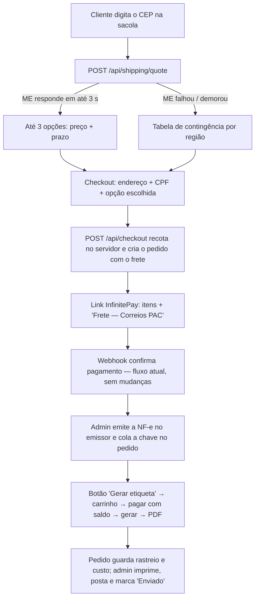

# Spec de implementação — Frete (versão enxuta, Melhor Envio)

> Status: **pronta para implementar, com pendências marcadas** · 17/10/2026 · sem código de produção.
>
> Feita para o volume atual: loja começando do zero, até ~50 pedidos/mês (≈ 2/dia), com a própria equipe
> embalando e postando. A versão completa (fila, vários provedores, etiqueta automática, rastreio por webhook)
> está guardada em [`spec-frete-v2.md`](./spec-frete-v2.md), com os sinais de quando migrar.
>
> Convenções: **🔎** = conferir na documentação oficial do Melhor Envio (docs.melhorenvio.com.br) antes de
> codar. **⏳** = valor provisório, a loja define depois.

## 0. Decisões tomadas

| Assunto | Decisão |
|---|---|
| Volume | Até ~50 pedidos/mês. Nada de fila, cache ou worker: tudo síncrono em rotas do Next. |
| Empresa | **ME (Microempresa) e emite NF-e.** O envio vai com a chave da NF-e, não com declaração de conteúdo. |
| Conta Melhor Envio | Existe, **em análise de identidade** (17/10/2026). Desenvolvimento no **sandbox**; produção só depois da aprovação. |
| CPF | **Obrigatório no checkout** (exigido na NF-e e pelas transportadoras). |
| Peso e medidas | **⏳ Provisórios por tipo de peça** (§2). A loja pesa e mede depois e só troca a tabela. |
| Etiqueta | Gerada **por um botão no `/admin`**, depois de emitir a NF-e. Não é automática. |
| Rastreio | Código de rastreio salvo no pedido e mostrado ao cliente com link. Sem webhook. |
| Autenticação no ME | **Token de acesso pessoal** gerado no painel do ME, numa env var. Sem fluxo OAuth. 🔎 validade e escopos |
| Provedores | Só o Melhor Envio. Código em um módulo pequeno; a interface genérica só nasce se entrar um 2º provedor (v2). |

---

## 1. Fluxo



O webhook da InfinitePay, o `payment_check` e a baixa de estoque continuam exatamente como estão em
`src/server/orders.ts`.

---

## 2. Peso e medidas (⏳ provisórios)

Ficam em código, em `src/data/shipping.ts`, junto do resto da configuração da loja. Valores para a peça
**dobrada e embalada individualmente** (saquinho), estimados para roupa fitness de poliamida/elastano:

| `kind` (de `src/data/catalog.ts`) | Peso ⏳ | Dobrada (C × L × A) ⏳ |
|---|---|---|
| `Blusa` (top, regata, camiseta) | 150 g | 25 × 20 × 2 cm |
| `Shorts` | 150 g | 25 × 20 × 2 cm |
| `Legging` | 250 g | 25 × 20 × 3 cm |
| `Conjunto` (top + legging/shorts) | 400 g | 25 × 20 × 5 cm |

Pacote do pedido (`buildPackage`):
- **Peso** = soma das peças + embalagem (⏳ envelope 30 g; caixa 150 g).
- **Embalagem:** até 3 peças (ou altura somada ≤ 8 cm) → **envelope de segurança** 32 × 40 cm, informado como
  30 × 25 × altura somada. Acima disso → **caixa** ⏳ 30 × 25 × 12 cm.
- Peso mínimo enviado ao ME: 300 g (evita recusa de peso muito baixo 🔎).
- **Valor declarado (seguro)** = valor dos itens, sem o frete.

Quando os valores reais existirem, só a tabela muda. Se no futuro cada produto tiver medida própria, entra
um campo opcional no `catalog.ts` que tem prioridade sobre o `kind`.

---

## 3. Cotação

`POST /api/shipping/quote` com `{ cep, lines: CartLine[], method }`. O navegador nunca manda peso nem preço.

1. Normalizar o CEP (8 dígitos) e validar a sacola com o `priceCart` existente.
2. Montar o pacote (§2).
3. Chamar `POST /api/v2/me/shipment/calculate` 🔎 com o CEP de origem, o CEP de destino, o pacote (cm/kg) e
   `insurance_value`, usando **`AbortSignal.timeout(3000)`**.
4. Filtrar: descartar os serviços que vêm com `error` ou sem preço/prazo, e os que não estão na lista
   permitida (`SHIPPING.services`: ⏳ Correios PAC, SEDEX e Mini Envios; Jadlog se aceitar NF-e de ME 🔎).
5. Aplicar as regras de preço (§4), ordenar pelo menor preço e devolver **no máximo 3**, marcando "mais
   barato" e "mais rápido".
6. Se o ME falhar, estourar o tempo ou não devolver nenhuma opção → **tabela de contingência** (§3.1), com
   `source: 'fallback'`.

Resposta: `{ options: [{ id, service, carrier, priceCents, days: { min, max } }], source }`. O prazo exibido
soma ⏳ 1 dia útil de manuseio: "chega em X a Y dias úteis".

Rate limit: regra na Vercel Firewall para a rota, como já existe para `/api/checkout` (ex. 30/min por IP).

### 3.1 Contingência ⏳

Um preço único por região, um pouco acima do real para não dar prejuízo. Também fica em `src/data/shipping.ts`:

| Região (UF pela faixa do CEP) | Preço ⏳ | Prazo ⏳ |
|---|---|---|
| Sudeste | R$ 25 | 4–8 dias úteis |
| Sul | R$ 30 | 5–9 |
| Centro-Oeste | R$ 33 | 5–10 |
| Nordeste | R$ 38 | 7–12 |
| Norte | R$ 45 | 8–15 |

O frete grátis (§4) também vale na contingência.

---

## 4. Regras de preço

Funções puras em `src/server/shipping/pricing.ts`, com testes (§10). Dinheiro sempre em **centavos
inteiros**.

1. **Frete grátis:** se o valor dos itens for ≥ `SHOP.freeShippingFrom` (R$ 299 hoje), a **opção mais barata**
   sai por R$ 0. As outras continuam pagas. ⏳ Vale para o Brasil todo, como diz a barra de anúncios hoje;
   se ficar caro para Norte/Nordeste, vira um valor por região.
2. **Taxa do cartão no frete:** ⏳ **desligada** no início. O frete custa o mesmo no Pix e no cartão.
   Se ligar depois: `ceil(custo × 10000 ÷ (10000 − bps))`, com a taxa de referência do 6x.
3. Sem margem nem arredondamento: o cliente paga o preço que o ME cotou.

---

## 5. Checkout

Front (sacola/checkout):
- Campo de **CEP** na sacola com cotação ao digitar, e a opção escolhida somada ao total.
- No checkout, o **endereço completo** preenchido pelo CEP (ViaCEP ou BrasilAPI, chamado pelo navegador) e
  editável: rua, número (aceita "S/N"), complemento, bairro, cidade e UF.
- **CPF obrigatório**, com validação dos dígitos verificadores no front e no servidor.
- Nome, e-mail e telefone continuam como hoje.

`POST /api/checkout` (alterado):
1. `priceCart` como hoje.
2. **Recotar no servidor** com os mesmos dados e procurar o serviço escolhido pelo cliente. Se o preço mudou,
   vale o novo; se o serviço sumiu, responde `409 shipping_changed` e o front mostra as opções de novo.
   Com isso não é preciso guardar a cotação em tabela nem controlar validade.
3. Criar o pedido com `items_total_cents`, `shipping_cents`, `total_cents = itens + frete`, o endereço, o CPF e
   o `shipping` (cópia da opção: serviço, id do serviço no ME, preço, prazo, `source`, pacote).
4. No link da InfinitePay, o frete vai como item separado (`"Frete — Correios PAC"`, quantidade 1). Com
   frete grátis, o item não entra.

O `confirmPayment` não muda: ele já compara `check.amount` com `total_cents`, que agora inclui o frete.

---

## 6. Etiqueta (painel `/admin`)

No detalhe de um pedido `paid` aparece o bloco **Envio**:

1. Campo **"Chave da NF-e"** (44 dígitos, com validação do dígito verificador). A NF-e é emitida fora do site,
   no emissor que a loja já usa.
2. Botão **"Gerar etiqueta"**, que roda numa server action só para `ADMIN_EMAILS`:
   1. Grava `shipping_status = 'buying'` só se estiver `null` ou `'failed'` (update condicional, como o
      `confirmPayment`). Se outro clique chegou antes, para.
   2. **Recota** o serviço escolhido. Se o custo subir mais que ⏳ R$ 3, mostra os dois valores e pede
      confirmação antes de seguir.
   3. Se o pedido ainda não tem `me_order_id`: `POST /api/v2/me/cart` 🔎 com remetente (dados do CNPJ),
      destinatário (nome, CPF, endereço, telefone, e-mail), pacote, `options.invoice.key` = chave da NF-e,
      `insurance_value` e `tag` = id do pedido. **Grava o `me_order_id` antes do próximo passo.**
   4. `POST /api/v2/me/shipment/checkout` 🔎 (paga com o saldo da carteira) → grava `label_cost_cents`.
   5. `POST /api/v2/me/shipment/generate` 🔎 → grava `tracking_code` se já vier.
   6. `shipping_status = 'ready'`.
   - Em erro: `shipping_status = 'failed'` com a mensagem do ME na tela (saldo insuficiente, endereço
     inválido…). O botão fica disponível de novo e **retoma do passo que faltou**: com `me_order_id`
     gravado, não cria outro carrinho. Antes de pagar de novo, consulta o pedido no ME 🔎 para não pagar duas
     vezes.
3. Botão **"Imprimir etiqueta"** → `POST /api/v2/me/shipment/print` 🔎 → abre a URL do PDF (não guardamos o
   PDF).
4. Depois de postar, o admin marca **Enviado** com o seletor de status que já existe. O código de rastreio
   aparece para o cliente na página do pedido, com link para o rastreio.
5. **Cancelar etiqueta** (antes de postar): botão que chama `POST /api/v2/me/shipment/cancel` 🔎 e limpa
   `me_order_id`. O estorno do pagamento continua manual na InfinitePay.

Saldo: o bloco mostra o saldo da carteira do ME (`GET /api/v2/me/balance` 🔎), para recarregar antes que
acabe.

---

## 7. Banco (uma migration)

```sql
alter table public.orders
  add column items_total_cents integer,                  -- backfill: = total_cents dos pedidos antigos
  add column shipping_cents integer not null default 0 check (shipping_cents >= 0),
  add column shipping jsonb,                             -- cópia da opção escolhida (serviço, preço, prazo, pacote, source)
  add column shipping_address jsonb,                     -- dado pessoal (§9)
  add column customer_cpf text,                          -- dado pessoal (§9); só dígitos
  add column nfe_key char(44),
  add column me_order_id text unique,
  add column label_cost_cents integer,
  add column tracking_code text,
  add column shipping_status text check (shipping_status in ('buying', 'ready', 'failed')),
  add column shipping_error text;
```

Sem tabelas novas. Tudo continua com RLS ligado e sem policies (só o back-end com a chave secreta acessa).

---

## 8. Melhor Envio

| Item | Valor |
|---|---|
| Bases | produção `https://melhorenvio.com.br`, sandbox `https://sandbox.melhorenvio.com.br` 🔎 |
| Cabeçalhos | `Authorization: Bearer <token>`, `Accept` e `Content-Type: application/json`, `User-Agent: BlessFit (<e-mail técnico>)` 🔎 |
| Token | Token pessoal gerado no painel de **cada** ambiente (contas separadas) 🔎 validade e renovação |
| Env vars | `MELHOR_ENVIO_ENV` (`sandbox` em Preview/Dev, `production` em Production), `MELHOR_ENVIO_TOKEN`, `MELHOR_ENVIO_USER_AGENT`, `SHIPPING_ORIGIN_CEP`, mais os dados do remetente (`SHIPPING_SENDER_*`: razão social, CNPJ, IE, endereço, telefone, e-mail) |
| Código | `src/server/shipping/melhor-envio.ts` (fetch + conversões cm/kg ↔ centavos), `pricing.ts`, `package.ts`; todos com `import 'server-only'` |
| Serviços | ids no ME ⏳ PAC = 1, SEDEX = 2, Mini Envios = 17 🔎 (conferir com `GET /api/v2/me/shipment/services`) |
| NF-e | Remetente CNPJ com NF-e: `options.non_commercial = false` e `options.invoice.key` 🔎. Confirmar quais transportadoras aceitam envio de ME pelo Melhor Envio. |
| Mini Envios | Tem limites de peso, altura e valor declarado 🔎. Um conjunto (400 g) provavelmente não cabe; a cotação já descarta o serviço quando o ME devolver erro. |

**Token expirado:** o ME responde 401 → cotação cai na contingência e o botão de etiqueta mostra "Token do
Melhor Envio expirado: gere um novo no painel e atualize a env var". 🔎 Se o token pessoal durar pouco, aí sim
vale migrar para OAuth (está descrito na v2).

---

## 9. Segurança e LGPD

- Token e dados do CNPJ só em env vars da Vercel. Nada em `src/data/`.
- CPF, endereço e telefone **nunca vão para log**. Nos logs, só o id do pedido e os 5 primeiros dígitos do CEP.
- A cotação recalcula tudo no servidor; o preço do frete do navegador é ignorado.
- Ações de etiqueta só para `ADMIN_EMAILS`.
- Política de privacidade: citar Melhor Envio e as transportadoras como operadores, e o CPF como dado exigido
  para a nota fiscal e o envio.
- Rodar o agente `security-reviewer` e atualizar `docs/seguranca.md` antes do deploy.

---

## 10. Testes

Vitest (ainda não existe no repo: adicionar `npm run test`), só no que mexe com dinheiro e com o pacote:
- `pricing`: frete grátis no limite exato (R$ 298,99 / R$ 299,00), só a opção mais barata fica grátis,
  máximo de 3 opções, ordenação.
- `package`: peso somado, troca de envelope para caixa, peso mínimo.
- Validação de CPF e da chave da NF-e.
- Adaptador do ME com respostas gravadas do sandbox: serviço com `error` é descartado, centavos certos,
  timeout cai na contingência.

Teste manual no Preview (sandbox): cotar → pagar → colar uma chave de NF-e de teste → gerar → imprimir →
cancelar.

---

## 11. Plano de entrega (~30 h)

| # | Tarefa | h |
|---|---|---|
| 1 | Conferir os 🔎 no sandbox do ME e gravar respostas de exemplo | 4 |
| 2 | `src/data/shipping.ts` (peso, medidas, contingência) + `package.ts` + `pricing.ts` + testes | 5 |
| 3 | Adaptador ME + `POST /api/shipping/quote` | 5 |
| 4 | Migration + `/api/checkout` com frete, recotação e item de frete na InfinitePay | 4 |
| 5 | Front: CEP na sacola, endereço com autocomplete, CPF, opções de frete | 7 |
| 6 | Admin: bloco Envio (NF-e, gerar, imprimir, cancelar, saldo) + rastreio na página do pedido | 5 |

Critérios de aceite:
- Cotação real em ≤ 3 s; com o ME desligado (token inválido), a contingência aparece.
- O total pago na InfinitePay = itens + frete, e o pedido vai para `paid`.
- Clicar duas vezes em "Gerar etiqueta" não compra duas etiquetas.
- Nenhum log com CPF, nome ou endereço.

---

## 12. Pendências

| # | Pendência | Bloqueia |
|---|---|---|
| 1 | **Aprovação da identidade no Melhor Envio** | Só a produção. Dá para desenvolver tudo no sandbox. |
| 2 | ⏳ **Peso e medidas reais** por tipo de peça + embalagem usada (envelope? caixa?) | Nada: os provisórios do §2 funcionam; trocar antes de abrir as vendas com frete. |
| 3 | **CEP de origem** e dados do remetente (razão social, CNPJ, IE, endereço, telefone). Sai de Divinópolis ou de BH? | Cotação real |
| 4 | Quais transportadoras/serviços aceitar (sugestão: Correios PAC, SEDEX e Mini Envios) | Nada (há padrão) |
| 5 | Frete grátis: continua R$ 299 para o Brasil todo? | Nada (há padrão) |
| 6 | Embutir a taxa do cartão no frete? (padrão: não) | Nada (há padrão) |
| 7 | Dias de manuseio (padrão: 1 dia útil) | Nada (há padrão) |
| 8 | Valores da tabela de contingência (§3.1) | Nada (há padrão) |
| 9 | Qual emissor de NF-e a loja usa (integrar no futuro para preencher a chave sozinho?) | Nada |
