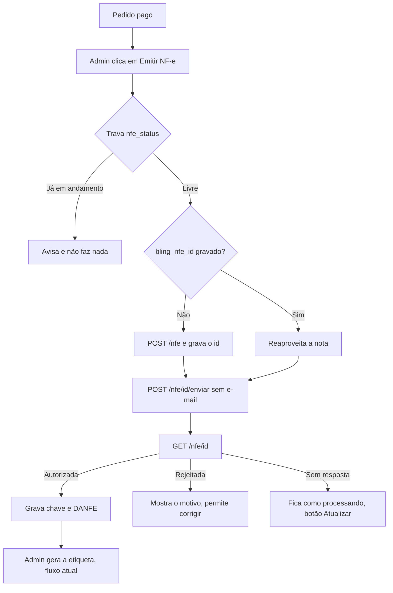

# Spec de implementação — Emissão de NF-e pelo painel (Bling)

> Status: **pronta para implementar depois dos pré-requisitos da §2** · 31/10/2026 · sem código de produção.
>
> Objetivo: o admin clica em um botão no pedido pago e o site emite a NF-e no Bling, grava a chave e deixa a
> etiqueta pronta para gerar, sem digitar a nota nem copiar a chave.
>
> Convenções: **📘** = respondido pela referência oficial, lida em 31/10/2026 (a página carrega o OpenAPI público
> `developer.bling.com.br/build/assets/openapi-CR5QY_N1.json`; o nome do arquivo muda a cada versão). **🧪** = a
> documentação não responde: testar na conta Bling em ambiente de teste antes de depender disso. **⏳** = depende
> do contador ou da loja.

## 0. Decisões tomadas

| Tema | Decisão | Motivo |
|---|---|---|
| Emissor | Bling, plano Cobalto, API v3 | Conta já assinada e configurada |
| Disparo | Botão no pedido, sem emissão automática | Nota autorizada com erro precisa ser cancelada ou corrigida |
| Volume | Até ~50 pedidos/mês, sem fila | Mesmo critério de `docs/spec-frete.md` |
| Forma de criar | `POST /nfe` direto, sem pedido de venda | Menos etapas; pedidos importados pela API contam no limite do plano |
| Regra fiscal | Fica na natureza de operação do Bling | Mudança fiscal não exige deploy |
| Certificado | Fica só no Bling | O site nunca recebe o `.pfx` nem a senha |
| Plano B | O campo de colar a chave continua | Bling fora do ar ou nota emitida direto nele |
| Cancelamento e devolução | Fora da v1, feitos no painel do Bling | Reduz risco na primeira entrega |

## 1. Estado atual

- **Empresa:** BLESSFIT STORE LTDA, CNPJ 69.633.993/0001-35, IE 005679033.00-62, Simples Nacional, Divinópolis/MG.
- **Bling:** dados da empresa, certificado A1 e naturezas configurados. A conta está no **ambiente de teste**.
- **Fluxo já validado à mão:** nota autorizada em teste → chave colada no painel → etiqueta no sandbox do Melhor
  Envio → PDF aberto.
- **Código relevante:**
  - `src/app/admin/_components/ShippingCard.tsx`: bloco de envio com o campo da chave.
  - `src/app/admin/actions.ts`: server actions; toda ação começa com `requireAdmin()`.
  - `src/server/shipping/label.ts`: etiqueta e trava em `shipping_status`, o padrão a seguir.
  - `src/server/shipping/melhor-envio.ts`: exemplo de cliente de API isolado, o padrão a seguir.
  - `src/server/orders.ts`: tipo `Order`. `nfe_key` já existe e aceita só 44 dígitos.
  - `src/lib/documents.ts`: `isNfeKey` valida a chave.
- **Ambientes locais:** `npm run dev` usa `scripts/dev.mjs`. Com `APP_ENV=hml`, o `.env.hml` vale por cima do
  `.env.local`. É lá que variáveis exclusivas de homologação devem ficar.
- **Next.js:** seguir o `AGENTS.md` e ler o guia em `node_modules/next/dist/docs/` antes de escrever código.

## 2. Pré-requisitos (bloqueiam o início ou a produção)

| # | Item | Responsável | Bloqueia |
|---|---|---|---|
| 1 | ⏳ NCM por tipo de peça, CFOP dentro e fora de MG, CSOSN | Contador | Produção |
| 2 | ⏳ Orientação para venda a consumidor final em outro estado (DIFAL) | Contador | Produção |
| 3 | Primeira nota **real** emitida à mão com sucesso | Loja | Início do código |
| 4 | Aplicativo criado em Central de Extensões > Área do Integrador, com visibilidade **Privado** 📘 (público exige homologação pelo Bling) | Loja | Teste real |
| 5 | Client ID e Client Secret na Vercel e no `.env.hml`, nunca no chat | Loja | Teste real |
| 6 | 📘 **Resolvido:** o plano Cobalto inclui a API. Ver abaixo | Dev | — |

**Plano Cobalto (item 6):** o [blog oficial do Bling](https://blog.bling.com.br/conheca-a-nova-versao-da-api-do-bling/)
(13/02/2026) diz que todos os recursos da API pública estão disponíveis a partir do plano Cobalto, e a
[página de planos](https://www.bling.com.br/planos-e-precos) lista capacidade de API "Padrão", notas fiscais
ilimitadas e até 200 pedidos por mês (só contam vendas de marketplaces e integrações via API). Nenhuma fonte cita
as rotas de NF-e por plano: a prova final é o primeiro `GET /nfe` depois de conectar. Um `403` ali para esta
implementação e deve ser levado ao suporte do Bling.

**Atenção à ordem (item 3):** uma nota real exige a conta em produção e os dados do contador (itens 1 e 2), mas o
item 3 bloqueia o início do código e os testes da §13 pedem a conta em teste. Decidir com a loja antes de codar.

## 3. Risco principal: o ambiente do Bling é da conta

O ambiente (teste ou produção) é uma configuração da **conta Bling**, não do site. Sem proteção:

- com a conta em produção, um teste no site de homologação emitiria uma **nota real**;
- com a conta em teste, o site de produção gravaria uma **chave sem valor fiscal** e poderia comprar etiqueta real.

Requisitos obrigatórios:

1. Variável `BLING_EMISSION_ENV`, com valor `test` ou `production`. Sem ela, a emissão fica desligada e o botão
   não aparece.
2. 📘 **A API não expõe o ambiente da conta.** `GET /empresas/me/dados-basicos` só traz id, nome, CNPJ, e-mail e
   data do contrato, e não há rota de configuração de NF-e. O host também é o mesmo nos dois ambientes. A comparação
   direta não é possível.
3. Portanto: depois da virada da conta para produção, deixar a variável vazia em homologação (botão desligado).
   Avaliar conta Bling separada para homologação.
4. Em produção, recusar também se `MELHOR_ENVIO_ENV` não for `production`, e vice-versa.
5. **Sonda antes de criar a nota (proposta, 🧪):** o changelog v336 diz que `GET /nfe/{id}` devolve
   `RESOURCE_NOT_FOUND` para nota criada em outro ambiente. `BLING_ENV_PROBE_NFE_ID` guarda o id de uma nota conhecida
   do ambiente esperado: resposta `200` libera a emissão; qualquer outra resposta recusa. Só dá para validar o `404`
   com a conta em outro ambiente, então fica para a virada (passo 8). Em produção não existe sonda antes da primeira
   nota real: essa depende da conferência manual.
6. **Conferência depois de autorizar:** ler `tpAmb` no XML (`1` produção, `2` homologação) e comparar com
   `BLING_EMISSION_ENV`. Divergindo, não gravar a chave nem liberar a etiqueta.

Depois de uma virada de ambiente, `GET /nfe/{id}` de nota antiga devolve `404`. **Atualizar** deve mostrar um aviso
e nunca criar outra nota.

Mesma lição do Melhor Envio: `.env.local` já misturou banco de homologação com a conta real e criou envio de
teste na conta de produção.

## 4. Fluxo



Emissão e etiqueta continuam **independentes**: se a etiqueta falhar, a nota segue válida e só a etiqueta é
tentada de novo. Um botão único "Emitir e gerar etiqueta" pode vir depois, chamando as duas funções.

## 5. Banco

Nova migration em `supabase/migrations/`:

```sql
alter table public.orders
  add column bling_nfe_id text unique,
  add column nfe_status text check (nfe_status in ('issuing', 'processing', 'authorized', 'rejected', 'blocked')),
  add column nfe_error text,
  add column nfe_danfe_url text;

create table public.bling_auth (
  id boolean primary key default true check (id),  -- linha única
  access_token text not null,                      -- criptografado
  refresh_token text not null,                     -- criptografado
  access_expires_at timestamptz not null,
  refresh_expires_at timestamptz not null,
  updated_at timestamptz not null default now()
);
alter table public.bling_auth enable row level security;  -- sem policies: só a chave secreta acessa
```

- `nfe_status` nulo = sem emissão pelo site, inclusive quando a chave foi colada à mão.
- `nfe_updated_at` (acrescentada na implementação): última mudança de `nfe_status`. Uma emissão travada em
  `issuing` sem `bling_nfe_id` há mais de 2 minutos pode ser liberada pelo admin, depois de conferir no Bling.
- `blocked` = situação sem nova tentativa pelo site (denegada, cancelada ou bloqueada no Bling). Ver §9.
- `nfe_danfe_url` traz o parâmetro `accessKey` 📘, que dá acesso ao documento: só no painel e nunca em logs.
- O JWT tem de 1.500 a 3.000 caracteres 📘; `text` comporta.
- Tokens criptografados com AES-GCM usando a env `BLING_TOKEN_KEY`. O refresh token permite emitir notas em nome
  da empresa.
- Conferir no Supabase os avisos de segurança da tabela nova.

## 6. Arquivos

| Arquivo | Conteúdo |
|---|---|
| `src/server/nfe/bling.ts` | Cliente da API. Nenhum tipo do Bling sai daqui. Limite de 3 req/s, erros legíveis, timeout |
| `src/server/nfe/auth.ts` | Troca do código, renovação com trava, leitura e gravação de `bling_auth` |
| `src/server/nfe/invoice.ts` | Monta a nota a partir do `Order`; função pura e testável |
| `src/server/nfe/issue.ts` | `issueInvoice(orderId)` e `refreshInvoice(orderId)`, com trava e retomada |
| `src/data/fiscal.ts` | NCM por `Kind` e demais dados fiscais fixos ⏳ |
| `src/app/admin/actions.ts` | `issueNfe` e `refreshNfe`, com `requireAdmin()` |
| `src/app/admin/_components/NfeCard.tsx` | Interface da §10 |
| `src/app/api/bling/callback/route.ts` | Retorno do OAuth. Exige admin logado e `state` válido |
| `src/app/api/cron/bling-refresh/route.ts` | Renovação agendada. Exige `CRON_SECRET` |
| `vercel.json` | Adiciona o cron diário (o plano Hobby permite execução diária) |
| Testes | `invoice.test.ts`, `issue.test.ts`, `bling.test.ts`, no padrão de `src/server/shipping/*.test.ts` |

## 7. Autenticação OAuth

**Confirmado na documentação:**

- O app é criado na Central de Extensões, e o `redirect_uri` e os escopos vêm do cadastro do app.
- O código de autorização vale **30 segundos** para ser trocado.
- `client_id:client_secret` vão em Basic no header `Authorization`, nunca no corpo.
- O refresh token dura **30 dias**.
- Alterar os escopos do app **revoga todos os usuários**: definir os escopos certos antes de conectar.
- Tokens opacos foram descontinuados: usar JWT.
- Mais de 20 chamadas a `/oauth/token` em 60 segundos bloqueiam o IP por 60 minutos.

**Respostas 📘:**

| Item | Resposta |
|---|---|
| Authorize | `GET https://www.bling.com.br/Api/v3/oauth/authorize?response_type=code&client_id=…&state=…` |
| Token e renovação | `POST https://api.bling.com.br/Api/v3/oauth/token`, form-urlencoded, com `Authorization: Basic` e `Accept: 1.0` |
| JWT | Enviar `enable-jwt: 1` no `/oauth/token` **e em todas as chamadas à API**. Sem o header, vem token opaco |
| Access token | `expires_in` na resposta; o exemplo oficial traz 21600 (6 h). Usar sempre o valor recebido |
| Código de autorização | Uso único. **Reutilizar um código ainda válido revoga o usuário**: o callback nunca repete a troca |
| Recusa no callback | Volta com `error` e `error_description` em vez de `code` |
| Conta inadimplente ou inativa | Pode impedir a autorização (`UNAUTHORIZED_ERROR`) e a renovação (`Empresa inativa`): tratar como "Reconectar Bling" |

**Sem resposta na documentação 🧪:**

- **Se o refresh token antigo deixa de valer:** não documentado. Tratar como se deixasse: gravar sempre o par
  recebido, dentro da trava. Também não está escrito que renovar reinicia os 30 dias; confirmar no primeiro cron.
- **Nomes dos escopos:** não estão no OpenAPI (a resposta traz só ids numéricos); aparecem na lista do cadastro do
  app. Marcar NF-e (consultar, criar, alterar, enviar), naturezas de operação e formas de pagamento. Testar se
  `POST /nfe` com contato e itens no corpo exige também os escopos de contatos e produtos: alterar escopos depois
  revoga a conexão.

**Implementação:**

1. O painel mostra "Conectar Bling" e gera `state` aleatório, guardado em cookie HttpOnly.
2. O callback valida `state` e admin, troca o código e grava os tokens.
3. Renovar antes de expirar, usando trava para duas requisições não renovarem juntas.
4. Cron diário renova o token, porque um período sem vendas poderia esgotar os 30 dias.
5. Falha definitiva: mostrar "Reconectar Bling" no painel, sem quebrar o resto do pedido.

## 8. Mapeamento da nota

Nomes de campo conforme o schema de `POST /nfe` 📘 (`*` = obrigatório no schema).

| Nota | Campo | Origem | Observação |
|---|---|---|---|
| Tipo | `tipo*` | Fixo `1` (saída) | `finalidade` fixa em `1` (normal) |
| Número | `numero*` | 🧪 | Obrigatório no schema, sem rota de "próximo número". Testar se o Bling numera sozinho quando vazio. **Maior dúvida em aberto** |
| Datas | `dataOperacao*`, `dataEmissao` | Hora da emissão | Formato `AAAA-MM-DD HH:MM:SS` |
| Natureza de operação | `naturezaOperacao.id*` | `BLING_NATUREZA_ID` | Uma por nota; a API de NF-e não aceita natureza por item. O CFOP por UF fica nas regras da natureza, sem natureza por UF no site. Testar fora de MG 🧪 |
| Indicador de presença | Nenhum | Natureza ou padrão do Bling | 📘 **A API não tem esse campo**: o "fixo `2`" não pode ser enviado. Conferir `indPres` no XML 🧪 (na tela, o valor voltou para `9`) |
| Intermediador | `intermediador` omitido | Venda no site próprio | Conferir `indIntermed` no XML 🧪 |
| Consumidor final | Nenhum | `contato.contribuinte = 9` | 📘 Sem campo na NF-e. Conferir `indFinal` no XML 🧪 |
| Destinatário | `contato{nome*, tipoPessoa* = F, numeroDocumento*, contribuinte* = 9, email, telefone, endereco{endereco*, numero, complemento, bairro*, cep, municipio*, uf}}` | `customer`, `customer_cpf` e `shipping_address` | CPF é obrigatório no checkout |
| Itens | `itens[]{codigo*, descricao, unidade = UN, quantidade, valor, tipo = P, pesoBruto, pesoLiquido, origem}` | `order.items` | Descrição com cor e tamanho. `origem` ⏳ |
| Código do item | `itens[].codigo*` | `{ref}-{cor}-{tamanho}` normalizado | Ver abaixo |
| NCM | `itens[].classificacaoFiscal` | `src/data/fiscal.ts` por `Kind` ⏳ | `6104.23.00` foi usado só em teste, nunca em produção |
| CFOP e CSOSN | `itens[].cfop` omitido | Regra da natureza | No teste: 5102 e 102. ⏳ Testar também fora de MG |
| Frete | `transporte.frete` | `shipping_cents` | 📘 Só existe o valor total, sem campo por item: o rateio fica com o Bling. Conferir o XML 🧪 |
| Desconto | `desconto` | `discount_cents` | ✅ Valor em reais (nota de teste nº 3: cupom de 10%, `vDesc` 0,40 rateado no item, `vNF` igual ao valor pago). `item.price` vai sem desconto |
| Transporte | `transporte{fretePorConta = 0, transportador.nome*, volume{quantidade = 1, especie = 2, pesoBruto, pesoLiquido}}` | `shipping.carrier` e `shipping.parcel` | Peso em kg. Não usar `volumes[]`, que é da logística do Bling |
| Pagamento | `parcelas[]{data*, valor*, formaPagamento.id*, caut}` | `method` e `paid_amount_cents` | `GET /formas-pagamentos` traz `tipoPagamento`: `17` Pix dinâmico, `20` Pix estático, `3` crédito. Gravar os ids em env |
| E-mail | Query `enviarEmail=false` | Fixo na v1 | Sem o parâmetro, vale o padrão da conta: sempre enviar |

**Lido no XML da nota de teste nº 1 (10/11/2026, natureza "Venda de mercadoria a não contribuinte"):** `tpAmb=2`,
`indPres=2` (internet), `indFinal=1` e `indIntermed=0`. A natureza já resolve presença, consumidor final e
intermediador: nenhum desses campos precisa ir na API. O `xml` de `GET /nfe/{id}` é um link assinado em
`www.bling.com.br`, lido sem token.

**Primeira nota pelo painel (nº 2, autorizada em 10/11/2026, teste):**

- `numero`: o `POST /nfe` sem número funciona, o Bling numera em sequência. O `PUT` **exige** o número da nota.
- Código sem produto cadastrado é aceito no item.
- Nota rejeitada pode ser corrigida com `PUT` e reenviada: o teste 5 da §13 passou.
- A parcela vence no dia da emissão. Com a data do pagamento (dias antes), a Sefaz rejeitou e o pagamento saiu
  como a prazo, com duplicata. Vencendo no dia, sai à vista (`indPag=0`) e sem duplicata.
- ⚠️ Na nota criada pela API, `indPres` saiu `9` (não presencial, outros), e não `2` (internet) como na nota feita
  na tela. A API não tem esse campo: precisa vir da natureza ou do Bling. Pendente para produção.
- Conferidos no XML: cupom (nota nº 3, `vDesc` em reais), frete pago (nota nº 4, `vFrete` 13,24 somado em `vNF`) e venda para SP (nota nº 5: `idDest` 2, CFOP **6108**, venda interestadual a não contribuinte, escolhido pela natureza do Bling). Duplo clique em **Emitir NF-e** (dois cliques no mesmo instante): uma nota só.

**Regras de validação antes de chamar o Bling:**

- Só `status === 'paid'`. Pedido `review` não emite.
- O total da nota precisa bater com `total_cents`.
- Sem `nfe_key` gravada à mão.
- Sem CPF, endereço ou NCM: recusar com mensagem específica.

**Código do produto:** o Bling recusou salvar "Conjunto … M" com um código já usado no produto "Conjunto … GG". O
código precisa ser único por variação. 📘 O item da nota não tem `produto.id`: vai só com `codigo` e os dados no
corpo, e o Bling usa o código para buscar dados do cadastro (changelog v345, CEST). 🧪 A documentação não diz se a
nota aceita código sem cadastro nem se isso cria produto: testar no primeiro `POST /nfe`.

## 9. Idempotência e estados

A trava segue `label.ts`: `update` condicional em `nfe_status`, aceitando só nulo ou `rejected`.

| Situação | Comportamento |
|---|---|
| Dois cliques | O segundo recebe "já em andamento" |
| Queda depois de criar a nota | `bling_nfe_id` já gravado: retoma e envia a mesma nota |
| Queda entre o `POST /nfe` e gravar o id | Referência candidata 📘: `loja.numero` (só escrita, exige `loja.id`) com `GET /nfe?numeroLoja=`. 🧪 A documentação não liga os dois, nem se a conta precisa de loja cadastrada. Sem isso, procurar por CPF em `GET /nfe` pela data de emissão e deixar para conferência manual; nunca criar outra nota automaticamente |
| Sefaz sem resposta | `processing`, botão **Atualizar** consulta `GET /nfe/{id}`, nunca cria outra nota |
| Rejeitada | `rejected`, motivo em `nfe_error`, e a retentativa **atualiza a mesma nota** com `PUT /nfe/{id}` e reenvia. 🧪 Ver abaixo |
| Denegada, cancelada ou bloqueada | `blocked`, sem nova tentativa pelo site; orientar a resolver no Bling |
| Contingência | 📘 A situação "Contingência" é descrita como exclusiva da NFC-e, e o enum da NF-e não tem esse valor. 🧪 Não dá para forçar em teste. A regra de `authorized` abaixo já impede gravar chave sem autorização; qualquer outra situação fica como `processing` |
| Etiqueta falhou | Não mexe na nota |
| Já autorizada | Botão some; a chave não pode ser sobrescrita pelo botão |

**Situações da NF-e 📘 → `nfe_status`:**

| `situacao` | Significado | `nfe_status` |
|---|---|---|
| `1` | Pendente | `issuing` (ainda não enviada) |
| `3`, `8`, `10` | Aguardando recibo, aguardando protocolo, consulta situação | `processing` |
| `7` | Registrada | `processing` até saber o que significa em NF-e 🧪 |
| `4` | Rejeitada | `rejected` |
| `5`, `6` | Autorizada, Emitida DANFE | `authorized`, se a regra abaixo passar |
| `2`, `9`, `11` | Cancelada, denegada, bloqueada | `blocked` |

**Nunca marcar `authorized` sem:** `situacao` `5` ou `6`, `isNfeKey(chaveAcesso)` verdadeiro e `tpAmb` igual a
`BLING_EMISSION_ENV` (§3).

**Pontos em aberto da retentativa e do motivo 🧪:**

- **`PUT` em nota rejeitada:** a descrição da rota só restringe notas autorizadas, mas o changelog v325 diz que não
  se atualizam dados fiscais de notas "já enviadas à SEFAZ". Testar (§13, item 5). Se o Bling recusar, a alternativa
  é `DELETE /nfe?idsNotas[]=` seguido de nota nova, depois de confirmar a situação `4`.
- **Motivo da rejeição:** `GET /nfe/{id}` não tem campo de motivo. O erro `400` de `POST /nfe/{id}/enviar` traz
  `error.message`, `error.description` e `error.fields[].msg`. Testar se a rejeição chega por aí; se chegar só a
  situação `4`, mostrar "veja o motivo no Bling" com link.
- **`POST /nfe/{id}/enviar`:** o `200` traz só `data.xml`, sem situação. Sempre confirmar com `GET /nfe/{id}`.

**DANFE e XML 📘:** `linkDanfe` e `linkPDF` vêm em `GET /nfe/{id}`. `GET /nfe/documento/{chave}?formato=pdf|xml`
devolve `data[].conteudo` em GZIP e base64.

**Limites da API (confirmados):** 3 req/s e 120 mil/dia por conta. Mais de 300 erros ou 600 requisições em 10
segundos bloqueiam o IP por 10 minutos. Tratar `429` sem repetição agressiva.

## 10. Interface

Bloco **Nota fiscal**, acima de **Envio**, em `/admin/pedidos/[id]`:

| Estado | Mostra |
|---|---|
| Bling desconectado | Conectar Bling e o campo de colar a chave |
| Pronto para emitir | Resumo curto (itens, total, NCM) e **Emitir NF-e** |
| `issuing` ou `processing` | Mensagem de andamento e **Atualizar** |
| `rejected` | Motivo e **Tentar de novo** |
| `authorized` | Número, chave, link do DANFE e aviso se for ambiente de teste |
| Chave colada à mão | A chave, com "emitida fora do site" |

Depois de autorizada, o campo da etiqueta já vem preenchido e o botão **Gerar etiqueta** continua sendo clicado
pelo admin. Confirmação antes de emitir em produção, com o total da nota.

## 11. Variáveis de ambiente

| Variável | Observação |
|---|---|
| `BLING_CLIENT_ID`, `BLING_CLIENT_SECRET` | Do aplicativo |
| `BLING_TOKEN_KEY` | Chave da criptografia dos tokens |
| `BLING_EMISSION_ENV` | `test` ou `production`; vazia desliga |
| `BLING_ENV_PROBE_NFE_ID` | Id da nota usada na sonda da §3 |
| `BLING_NATUREZA_ID` | ⏳ Depois de conferida pelo contador |
| `BLING_FORMA_PAGAMENTO_PIX_ID`, `BLING_FORMA_PAGAMENTO_CARTAO_ID` | Ids de `GET /formas-pagamentos` |
| `CRON_SECRET` | Proteção do cron |

📘 Não há `BLING_REDIRECT_URI`: o Bling ignora o `redirect_uri` da requisição e usa o único "Link de redirecionamento"
do cadastro. Por isso é **um app por endereço** (teste e produção). 🧪 Testar se aceita `localhost`.

Documentar no `README.md` e adicionar as de homologação ao `.env.hml`. O que falta para produção está em
`docs/pendencias-prod-nfe.md`.

## 12. Segurança

- Tokens, chave de criptografia, CPF e endereço fora de logs. Logar só id do pedido e código de erro.
- Toda action com `requireAdmin()`. Callback com admin e `state`. Cron com `CRON_SECRET`.
- Mensagens do Bling mostradas sem HTML e sem dados pessoais desnecessários.
- Rodar o agente `security-reviewer` antes do deploy, porque a mudança toca `/admin`, `src/server/` e migrations.

## 13. Testes

**Automatizados (Bling simulado):**

- `invoice`: dentro e fora de MG, frete grátis e pago, cupom, vários itens, soma igual a `total_cents`, código por
  variação, recusa sem NCM ou CPF.
- `issue`: dois cliques, retomada com `bling_nfe_id`, rejeição, `processing`, chave inválida recusada, pedido não
  pago recusado, divergência de ambiente recusada.
- `auth`: renovação, duas renovações juntas, refresh expirado, `state` inválido.

**Manuais, com Bling em teste e sandbox do Melhor Envio (`APP_ENV=hml`):**

1. Conectar o Bling.
2. Pedido com frete grátis em MG: emitir, conferir o XML, gerar etiqueta, imprimir.
3. Pedido com frete pago e pedido com cupom: conferir os totais no XML.
4. Pedido para outro estado: conferir o CFOP.
5. Forçar rejeição (por exemplo, NCM inválido): corrigir e reenviar **sem criar nota nova**.
6. Clicar duas vezes em **Emitir NF-e**: só uma nota no Bling.
7. Desconectar o Bling: painel avisa, e colar a chave à mão continua funcionando.
8. Emitir com `BLING_EMISSION_ENV` divergente: recusa antes de chamar a emissão.

**Produção:** primeira nota com pedido real de baixo valor. Consultar a chave no Portal da NF-e e acompanhar até
a postagem.

## 14. Ordem de implementação

1. Ler a referência oficial e resolver os 🔎 de §7, §8 e §9. Registrar a resposta nesta spec.
2. Migration, `bling.ts` e `auth.ts`, com conexão funcionando e cron.
3. `fiscal.ts` e `invoice.ts`, com testes.
4. `issue.ts` com a proteção de ambiente da §3.
5. Actions e `NfeCard`.
6. Testes manuais da §13 em homologação.
7. `security-reviewer`, ajustes e README.
8. Produção: virar o Bling, configurar as variáveis e emitir a primeira nota monitorada.

## 15. Fora de escopo

Emissão automática por webhook, cancelamento, carta de correção, devolução, envio de e-mail da nota, estoque e
contas a receber no Bling, sincronização de catálogo, NFC-e e NFS-e.

## 16. Referências

- [Bling: autenticação e aplicativos](https://developer.bling.com.br/aplicativos)
- [Bling: limites da API](https://developer.bling.com.br/limites)
- [Bling: changelog (POST /nfe e enviarEmail)](https://developer.bling.com.br/changelogs)
- [Bling: referência da API](https://developer.bling.com.br/referencia)
- [Bling: OpenAPI lido em 31/10/2026](https://developer.bling.com.br/build/assets/openapi-CR5QY_N1.json)
- [Bling: migração para JWT](https://developer.bling.com.br/migracao-jwt)
- [Bling: erros comuns](https://developer.bling.com.br/erros-comuns)
- [Bling: API a partir do plano Cobalto](https://blog.bling.com.br/conheca-a-nova-versao-da-api-do-bling/)
- [Bling: planos e preços](https://www.bling.com.br/planos-e-precos)
- [Bling: emitir NF-e na tela](https://ajuda.bling.com.br/hc/pt-br/articles/360035829513)
- [Bling: planos 2026 e limite de pedidos via API](https://ajuda.bling.com.br/hc/pt-br/articles/30224184866583-Altera%C3%A7%C3%A3o-nos-planos-e-pre%C3%A7os-do-Bling-em-abril-de-2026)
