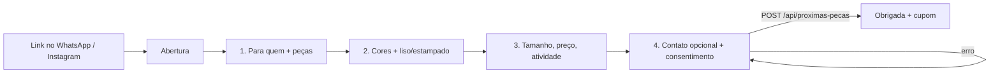

# Spec de implementação — Pesquisa “Próximas peças”

> Status: **pronta para implementar** · 16/10/2026 · decisões da seção 12 respondidas · sem código de produção.
>
> Design de referência: https://claude.ai/artifact/9VQGzChoXDf8vm4ck55SUD
> (artboards “Formulário (celular)” e “Painel /admin — respostas”). As listas de peças e cores mudaram
> depois do design: vale a seção 3.
>
> Única pendência: as imagens das peças, que chegam depois (seção 3.1). A página funciona sem elas.

## 0. Resumo

Uma página pública, **`/proximas-pecas`**, onde a cliente responde em 4 etapas quais peças, cores, tamanho,
faixa de preço e atividade ela quer na próxima coleção. No fim, ela recebe o cupom **BLESS10** (10% na
próxima compra). Se quiser,
deixa WhatsApp ou e-mail para ser avisada do lançamento.

As respostas ficam no Supabase. O painel ganha a aba **Próximas peças**, com os totais (peças, cores,
grade de tamanhos e preço), as últimas respostas e uma exportação para Excel.

**Objetivo de negócio:** decidir o pedido de produção (modelo × cor × grade de tamanhos) com base em
demanda declarada, e formar uma lista de contatos com consentimento para avisar do lançamento.

**Fora do escopo do MVP:**
- envio automático de WhatsApp ou e-mail no lançamento (fase 2, seção 9);
- cupom aplicado automaticamente no checkout (o checkout ainda não tem cupom, seção 6);
- várias pesquisas abertas ao mesmo tempo e editor de perguntas no painel (as opções ficam no código).

---

## 1. Como a loja funciona hoje (o que a spec segue)

| Necessidade | Como fica | Por quê |
|---|---|---|
| Página | **Next.js 16 App Router**: `src/app/proximas-pecas/page.tsx`, com styled-components e Montserrat do `GlobalStyle` | Mesma stack da loja e do painel |
| Envio das respostas | **Route handler** `POST /api/proximas-pecas` | Igual a `/api/checkout`. Rota com caminho fixo, que dá para limitar no Firewall da Vercel |
| Banco | **Supabase Postgres**, tabela nova com RLS ligado e **sem policies**. Só o back-end escreve e lê, com `db()` | Mesmo padrão de `orders` e `order_events` |
| Opções do formulário | **`src/data/survey.ts`**: peças, cores, tamanhos, faixas de preço e atividades | Igual a `catalog.ts`. Muda pouco e precisa de revisão no código |
| Painel | `src/app/admin/(painel)/proximas-pecas/page.tsx` + `requireAdmin()` | Toda página e rota do painel chama `requireAdmin()` por conta própria (auditoria de 14/10) |
| Excel | `exceljs`, igual a `src/server/export.ts` | Já instalado |
| Código de servidor | `src/server/survey.ts` com `import 'server-only'` | Regra da auditoria de 14/10 |

---

## 2. Fluxo da cliente



Tudo em uma página só, como no design. As etapas são estado do React; a URL não muda.

| Etapa | Pergunta | Tipo | Obrigatória | Regras |
|---|---|---|---|---|
| Abertura | — | — | — | Benefícios: menos de 2 minutos, 10% de desconto, aviso no lançamento. Botão **Começar** |
| 1 | As peças são para quem? | Escolha única: `f` Feminino · `m` Masculino · `a` Os dois | Sim | Filtra a lista de peças abaixo |
| 1 | Quais peças você compraria? | Várias | Sim, mínimo 1 | Atuais e novas (selo **NOVA**). Uma peça só aparece se combinar com o gênero escolhido ou servir para os dois |
| 2 | Quais cores você usaria? | Várias, **até 4** | Sim, mínimo 1 | Dois grupos: “Cores da loja hoje” e “Novas ideias”. Ao marcar a 5ª, a cor não entra e aparece um aviso |
| 2 | Outra cor que você gostaria? | Texto, até 40 caracteres | Não | — |
| 2 | Liso ou estampado? | Única: `liso` · `estampa` · `tanto` | Sim | — |
| 3 | Qual o seu tamanho? | Única: PP · P · M · G · GG | Sim | — |
| 3 | Quanto pagaria por um conjunto? | Única: `p1`…`p4` | Sim | Faixas na seção 3 |
| 3 | Para qual atividade? | Várias | Não | — |
| 4 | Nome, WhatsApp, e-mail | Texto | Não | Se qualquer contato for preenchido, o consentimento é obrigatório |
| 4 | Consentimento | Checkbox | Só com contato | Texto exato na seção 7 |
| Final | — | — | — | “Obrigada!”, cupom **BLESS10** (“10% OFF na sua próxima compra”) com botão **Copiar cupom**, link **Ver a loja** |

**Validação na tela:** o botão **Continuar** só funciona quando a etapa está completa. Se faltar algo,
aparece um aviso embaixo da pergunta, por exemplo “Escolha pelo menos uma peça”. O botão não fica cinza
sem explicação.

**Rascunho:** as respostas em andamento ficam no `localStorage` (`blessfit:survey:<campanha>`) com
`try/catch`. Se a cliente fechar o WhatsApp e voltar, continua de onde parou. O rascunho é apagado depois
do envio, e o navegador guarda `enviado: true` para mostrar direto a tela final com o cupom.

**Acessibilidade:** os cartões de peça, as bolinhas de cor e as pílulas são `<button aria-pressed>`, e o
tamanho e o preço são `radiogroup`. Toda bolinha de cor tem o nome escrito embaixo, e cada passo de etapa
tem `aria-live` com “Etapa 2 de 4”. As áreas de toque têm no mínimo 44 px.

---

## 3. Opções — `src/data/survey.ts`

O arquivo é a única fonte das opções, para a página, a API (validação) e o painel (rótulos).

```ts
export const SURVEY = {
  campaign: 'proximas-pecas-2026', // nome interno; muda a cada nova rodada da pesquisa
  title: 'Próximas Peças 2026',
  closesAt: '2026-11-15T23:59:59-03:00', // 1 mês no ar; depois disso a página mostra “Pesquisa encerrada”
  maxColors: 4,
  coupon: SHOP.firstPurchaseCoupon, // BLESS10, 10% — ver seção 6
} as const

export type Who = 'f' | 'm' | 'u'

export const SURVEY_PIECES: { id: string; label: string; who: Who; isNew?: boolean; image?: string }[] = [
  // atuais
  { id: 'conjunto', label: 'Conjunto', who: 'u' },
  { id: 'legging', label: 'Legging', who: 'f' },
  { id: 'top', label: 'Top', who: 'f' },
  { id: 'shorts', label: 'Shorts', who: 'u' },
  { id: 'regata', label: 'Regata', who: 'u' },
  { id: 'camiseta', label: 'Camiseta', who: 'm' },
  // novas — femininas
  { id: 'macaquinho', label: 'Macaquinho', who: 'f', isNew: true },
  { id: 'flare', label: 'Legging flare', who: 'f', isNew: true },
  { id: 'ciclista', label: 'Bermuda ciclista', who: 'f', isNew: true },
  { id: 'saia', label: 'Saia-shorts', who: 'f', isNew: true },
  { id: 'cropped', label: 'Cropped manga longa', who: 'f', isNew: true },
  // novas — masculinas
  { id: 'shorts2em1', label: 'Shorts 2 em 1', who: 'm', isNew: true },
  // novas — para os dois
  { id: 'oversized', label: 'Camiseta oversized', who: 'u', isNew: true },
  { id: 'jogger', label: 'Calça jogger', who: 'u', isNew: true },
  { id: 'jaqueta', label: 'Jaqueta corta-vento', who: 'u', isNew: true },
]

// cores atuais: as mesmas de src/data/catalog.ts (reaproveitar as constantes, não copiar os hex)
export const SURVEY_COLORS_NOW = ['preto', 'grafite', 'branco', 'coral', 'petroleo', 'marinho']
export const SURVEY_COLORS_NEW: { id: string; name: string; hex: string }[] = [
  { id: 'salvia', name: 'Verde Sálvia', hex: '#9caf88' },
  { id: 'oliva', name: 'Verde Oliva', hex: '#5f6b3a' },
  { id: 'menta', name: 'Verde Menta', hex: '#a8dcc6' },
  { id: 'mocha', name: 'Mocha', hex: '#7b5e4b' },
  { id: 'terracota', name: 'Terracota', hex: '#b5573a' },
  { id: 'areia', name: 'Areia', hex: '#cdbfa8' },
  { id: 'rosaantigo', name: 'Rosa Antigo', hex: '#d4a5a5' },
  { id: 'lavanda', name: 'Lavanda', hex: '#b9a6d3' },
  { id: 'azulnuvem', name: 'Azul Nuvem', hex: '#a9c3dc' },
  { id: 'vinho', name: 'Vinho', hex: '#6e1f2e' },
]

// baseadas nos conjuntos do site (cartão): Maré 139,90 · Fôlego 147,90 · Impulso 154,90 · Brisa 159,90 · Aurora 164,90
export const SURVEY_PRICES = [
  { id: 'p1', label: 'Até R$ 130' },        // abaixo da linha atual
  { id: 'p2', label: 'R$ 130 a R$ 160' },   // onde está a maioria dos conjuntos hoje
  { id: 'p3', label: 'R$ 160 a R$ 190' },   // Aurora e um degrau acima
  { id: 'p4', label: 'Acima de R$ 190' },   // espaço para uma linha premium
]

export const SURVEY_ACTIVITIES = [
  { id: 'academia', label: 'Academia' }, { id: 'corrida', label: 'Corrida' },
  { id: 'yoga', label: 'Yoga / Pilates' }, { id: 'funcional', label: 'Funcional / Cross' },
  { id: 'dia', label: 'Dia a dia' },
]
```

**Regra de versão:** dentro de uma campanha, um id **nunca** é renomeado nem reaproveitado, porque as
respostas já gravadas apontam para ele. Para tirar uma opção, basta removê-la da lista: as respostas
antigas continuam válidas e o painel mostra o id cru. Para trocar perguntas, crie uma campanha nova.

### 3.1 Imagens das peças

As imagens vêm depois, feitas no Google Flow já nas cores certas. Até lá:
- `image` fica vazio em todas as peças, e o cartão mostra um fundo neutro (`--surface`) com o ícone de
  cabide e o nome da peça, como no design. Nada quebra sem imagem.
- Quando as imagens chegarem: vão para `public/survey/<id da peça>.webp` (ex. `macaquinho.webp`), com
  proporção 4:5 e cerca de 600 px de largura. O campo `image` recebe o caminho, e o cartão passa a usar
  `next/image`. É uma mudança só de dados, sem mexer na lógica.
- Se as imagens vierem por cor (ex. macaquinho em sálvia), o nome segue `<peça>-<cor>.webp`, e a etapa
  de cores pode mostrar a peça mais marcada na etapa 1 na cor tocada. Isso é opcional e fica para quando
  as imagens existirem.

### 3.2 De onde saiu a lista de peças e cores novas

Pesquisa de tendências feita em 16/10/2026, com fontes de marcas e blogs de varejo. Nenhuma publica dados
de venda, então a lista é uma aposta orientada, e é justamente isso que a pesquisa vai confirmar com as
clientes.

| Escolha | Motivo |
|---|---|
| Macaquinho | Apontado como destaque da temporada por mais de uma marca brasileira |
| Legging flare | Silhueta em alta, principalmente para yoga e pilates |
| Bermuda ciclista, saia-shorts | Shorts de cintura alta e peças de alta rotação no varejo fitness feminino |
| Cropped manga longa | Athleisure: peça que vai do treino para a rua |
| Shorts 2 em 1 (masc.) | Shorts curtos e de toque macio crescendo no masculino |
| Camiseta oversized, calça jogger | Conforto e uso fora da academia, para os dois públicos |
| Jaqueta corta-vento | Complemento de conjunto para corrida e uso urbano |
| Sálvia, oliva, menta | Verdes suaves são as cores mais citadas para 2026. Oliva também aparece no masculino e combina com a marca |
| Mocha, terracota, areia | Tons terrosos substituindo o preto como base |
| Rosa antigo, lavanda, azul nuvem | Tons claros e suaves para tops, leggings e conjuntos |
| Vinho | O vermelho fechado como cor de destaque |

Ficaram de fora o **neon em conjunto completo** (as fontes dizem que está saindo) e o **marrom escuro
liso**, por ser parecido demais com o mocha.

Fontes: [ND Mais — Moda fitness 2026](https://ndmais.com.br/moda-e-beleza/moda-fitness-2026-tendencias-athleisure-conquitsta-ruas/) ·
[Pozze — Moda fitness 2025/2026](https://www.pozze.com.br/blogs/news/moda-fitness-2025-2026-conheca-as-tendencias-que-vao-dominar-as-academias) ·
[Supervaidosa — Moda fitness 2026 para lojistas](https://www.supervaidosaactive.com.br/como-lucrar-com-moda-fitness-em-2026-dicas-para-lojistas-e-revendedores) ·
[Summer Soul — Tendências fitness 2026](https://www.summersoul.com.br/post/tend%C3%AAncias-fitness-2026-estilo-e-performance-em-alta-com-pe%C3%A7as-chave-da-nova-esta%C3%A7%C3%A3o) ·
[Vitality — 2026 Activewear Color Trends](https://shopvitality.com/blogs/vitality-blog/activewear-color-trends) ·
[Trendalytics — Activewear trends 2026](https://trendalytics.co/trend-insights/activewear-athleisure-trends-2026-us-retail-trends-forecast) ·
[Trendalytics — activewear updates 2026](https://blog.trendalytics.co/activewear-trends-updates-for-2026) ·
[Fitness Clothing Manufacturer — color stories](https://www.fitnessclothingmanufacturer.com/activewear-fashion-key-color-stories-dominating-now/) ·
[Suitable — men's spring/summer trends](https://www.suitableshop.com/stories/mens-spring-and-summer-fashion-trends/)

---

## 4. Banco — migration `20261016000000_survey_responses.sql`

```sql
-- Respostas da pesquisa "Próximas peças". Só o back-end (chave secreta) lê e escreve.
create table public.survey_responses (
  id uuid primary key default gen_random_uuid(),
  campaign text not null,
  who text not null check (who in ('f', 'm', 'a')),
  pieces text[] not null check (cardinality(pieces) between 1 and 20),
  colors text[] not null check (cardinality(colors) between 1 and 4),
  other_color text check (char_length(other_color) <= 40),
  pattern text not null check (pattern in ('liso', 'estampa', 'tanto')),
  size text not null check (size in ('PP', 'P', 'M', 'G', 'GG')),
  price_range text not null,
  activities text[] not null default '{}' check (cardinality(activities) <= 10),
  -- contato: só gravado com consentimento
  name text check (char_length(name) <= 60),
  phone text check (phone ~ '^[0-9]{10,11}$'),        -- só dígitos, com DDD
  email text check (char_length(email) <= 254),
  consent boolean not null default false,
  consent_at timestamptz,
  consent_text text,                                  -- versão do texto aceito (seção 7)
  check (not consent or (consent_at is not null and consent_text is not null)),
  check ((phone is null and email is null and name is null) or consent),
  created_at timestamptz not null default now(),
  updated_at timestamptz not null default now()
);

alter table public.survey_responses enable row level security; -- sem policies: só o back-end

create index survey_responses_campaign_idx on public.survey_responses (campaign, created_at desc);

-- uma resposta por contato em cada campanha: vale a primeira; as seguintes são ignoradas
-- (null não conflita com null; o e-mail já é gravado em minúsculas)
create unique index survey_responses_phone_uq on public.survey_responses (campaign, phone);
create unique index survey_responses_email_uq on public.survey_responses (campaign, email);
```

Decisões:
- **Os ids das opções não viram `check`** no banco. A validação fica no servidor, contra `survey.ts`, para
  que trocar opções não exija migration. O banco só limita tamanhos e formatos.
- **IP e user-agent não são gravados.** A proteção contra abuso fica no firewall (seção 5), e assim
  guardamos menos dado pessoal.
- **Resposta sem contato** é anônima e entra sempre. **Resposta com contato repetido** (mesmo WhatsApp ou
  e-mail na mesma campanha) é **ignorada**: vale a primeira. A cliente recebe o cupom do mesmo jeito.
  Isso evita contar duas vezes a mesma pessoa. A resposta nunca é atualizada, porque quem soubesse o
  contato de outra pessoa poderia trocar as respostas e o consentimento dela (revisão de segurança de 16/10).

---

## 5. API — `POST /api/proximas-pecas`

Arquivo: `src/app/api/proximas-pecas/route.ts`. Regra de negócio fica em `src/server/survey.ts`
(`parseSurvey`, `saveSurvey`).

**Corpo (JSON, até 4 KB):**

```json
{
  "campaign": "2026-verao",
  "who": "f",
  "pieces": ["conjunto", "macaquinho"],
  "colors": ["oliva", "preto"],
  "otherColor": "verde menta",
  "pattern": "liso",
  "size": "M",
  "price": "p2",
  "activities": ["academia"],
  "contact": { "name": "Ana", "phone": "(37) 99999-0000", "email": "ana@exemplo.com" },
  "consent": true,
  "website": ""
}
```

**Validação no servidor (`parseSurvey`)**: nada do que vem do navegador é confiável.
1. `Content-Length` acima de 4 KB → **413**. JSON inválido → **400**.
2. `campaign` diferente de `SURVEY.campaign`, ou data depois de `closesAt` → **410** `{ error: 'Pesquisa encerrada' }`.
3. `website` (honeypot, campo escondido na tela) preenchido → **200** com o cupom, mas **sem gravar**. Robô
   não fica sabendo que foi barrado.
4. Toda escolha precisa existir em `survey.ts`. Listas sem itens repetidos. `pieces` precisa combinar com
   `who`, `colors` vai de 1 a `maxColors` e `activities` é opcional. Qualquer coisa fora disso → **400**,
   com mensagem em português.
5. Texto livre (`otherColor`, `name`): `trim`, sem quebras de linha, dentro do limite de tamanho. Vazio vira `null`.
6. `phone`: fica só com os dígitos, tira o `55` do começo se tiver 12–13 dígitos, e precisa sobrar 10–11
   dígitos. `email`: formato simples (`x@y.z`), em minúsculas, até 254 caracteres.
7. Contato preenchido e `consent !== true` → **400** “Para receber avisos, marque a autorização”.
8. Grava sempre com `insert`. Se der chave única repetida (`23505`, mesmo WhatsApp ou e-mail na campanha),
   a resposta é ignorada e a API devolve 200 com o cupom.
   `consent_at = now()` e `consent_text = CONSENT_VERSION`.

**Resposta 200:** `{ "ok": true, "coupon": { "code": "…", "percent": 10 } }`. Erro: `{ "error": "…" }`,
no formato do `json()` de `src/server/orders.ts`. Erro do banco → **500** com `console.error('[survey] …')`,
sem dados da cliente no log.

**Proteção contra abuso:**
- **Firewall da Vercel:** `POST /api/proximas-pecas` entrou na mesma regra de rate limit de `/api/checkout`
  e `/admin/login`, com **10 por minuto por IP**. O plano Hobby só permite uma regra de rate limit
  (registrado em `docs/seguranca.md`).
- Honeypot (passo 3) e limite de tamanho do corpo (passo 1).
- O cupom não é segredo (seção 6). Por isso, enviar várias vezes não dá vantagem, só sujaria os números,
  e o rate limit e o upsert por contato seguram isso.

---

## 6. Cupom — BLESS10 na próxima compra

Decidido: a pesquisa entrega o **mesmo cupom `BLESS10`** (10%), válido para a **próxima compra**, e não só
para a primeira.

- A página lê o código de `SHOP.firstPurchaseCoupon` (`src/data/shop.ts`) e não escreve `BLESS10` à mão.
  Se o código mudar lá, muda aqui também.
- Texto na tela final: “**10% OFF na sua próxima compra** com o cupom BLESS10”. A tela não fala em
  “primeira compra”, porque quem responde muitas vezes já é cliente.
- **Hoje o checkout não aplica cupom.** O `BLESS10` é dado na conversa pelo WhatsApp ou em link de
  pagamento manual. A pesquisa segue o mesmo caminho, e nada muda no checkout nesta fase.
- **Combinar com a equipe:** quem atende no WhatsApp deve aceitar o `BLESS10` também de quem já comprou
  e vier da pesquisa. Sem isso, a promessa da tela final não é cumprida.
- O botão **Copiar cupom** usa `navigator.clipboard.writeText`. Se falhar (navegador interno de app),
  o código fica selecionável na tela.
- O card “cupons usados” do design fica para a **fase 2** (seção 9), quando o checkout souber aplicar
  cupom.

---

## 7. LGPD e consentimento

- **Texto do consentimento** (`CONSENT_VERSION = '2026-10-16'`):
  “Aceito receber mensagens da BlessFit sobre lançamentos e promoções. Posso cancelar quando quiser.”
  Sem link para política de privacidade nesta fase. O link do design sai.
- **Finalidade:** avisar do lançamento e mandar promoções. Os dados não são usados para nada além disso.
- **Mínimo de dados:** contato opcional, sem IP e sem data de nascimento. As respostas anônimas continuam
  úteis para a produção.
- **Retenção:** os contatos de uma campanha são apagados (`name`, `phone` e `email` viram `null`,
  `consent=false`) **12 meses depois do `closesAt`**. As respostas anônimas ficam para comparar coleções.
  Na fase 2, um Vercel Cron mensal faz isso. No MVP, fica como item manual registrado aqui.
- **Pedido de exclusão:** o painel tem o botão **Remover contato** em cada resposta (seção 8), que faz a
  mesma anonimização.
- **Exportação:** a planilha leva contatos e, por isso, segue a regra da exportação atual: admin
  obrigatório, `Cache-Control: no-store` e texto gravado como célula de texto do `exceljs`, nunca como
  fórmula. Um nome começando com `=` aparece como texto e não é calculado.

---

## 8. Painel — `/admin/proximas-pecas`

Arquivos:
- `src/app/admin/(painel)/proximas-pecas/page.tsx` (+ `loading.tsx` com `Skeleton`, igual às outras abas)
- `src/app/admin/proximas-pecas/exportar/route.ts`
- `src/app/admin/_components/AdminNav.tsx`: novo item **Próximas peças** com ícone novo em `Icons.tsx`
- `src/app/admin/actions.ts`: `removeSurveyContact(id)` com `requireAdmin()`

Conteúdo (seguindo o artboard “Painel /admin — respostas”):

| Bloco | Cálculo |
|---|---|
| Respostas | `count(*)` da campanha atual |
| Querem ser avisadas | `count(*) where consent` |
| Mais pedido | peça mais marcada + cor mais marcada + tamanho mais comum + faixa de preço mais comum |
| Peças mais pedidas | contagem por id de `pieces` (`unnest`), barras ordenadas da maior para a menor |
| Cores mais pedidas | o mesmo para `colors`, com a bolinha de cor |
| Grade sugerida | % por tamanho. **Recorte por peça**: um seletor “Todas / Conjunto / Legging / …” refaz a grade só com quem marcou aquela peça, que é o número que vai para o pedido de produção |
| Faixa de preço | contagem por `price_range` |
| Outras cores sugeridas | `other_color` agrupado sem diferenciar maiúsculas, top 10 |
| Últimas respostas | 20 mais recentes: nome (ou “Anônima”), peças, cores, tamanho, preço, aviso (WhatsApp / E-mail / Não), botão **Remover contato** |
| Copiar link do formulário | copia `https://www.blessfitstore.com.br/proximas-pecas` |
| Exportar Excel | ver abaixo |

Cálculo: com centenas de respostas, basta ler a campanha inteira (`select` das colunas, sem contatos para
os totais) e somar em `src/server/survey.ts` (`surveySummary`). Uma função SQL de agregação só vale a pena
acima de algo como 20 mil respostas.

**Excel** (`buildSurveyWorkbook`, no estilo de `export.ts`):
- aba **Respostas**: uma linha por resposta, com data, gênero, peças, cores, outra cor, estampa, tamanho,
  preço, atividades, nome, WhatsApp, e-mail e consentimento;
- aba **Resumo**: as mesmas tabelas do painel;
- aba **Grade por peça**: linhas = peça, colunas = PP…GG, com a contagem. É a base do pedido de produção.

---

## 9. Fases

**Fase 1 (MVP, esta spec):** página, API, tabela, painel, Excel, cupom BLESS10 na tela final, regra no
firewall.

**Fase 1.1 (quando as imagens chegarem):** colocar as fotos das peças (seção 3.1).

**Fase 2:**
- “Avisar lançamento”: no painel, escolher uma peça e uma cor e gerar a lista de quem marcou, com links
  `wa.me` prontos. O envio automático pela API do WhatsApp Business é um projeto à parte.
- Cupom validado no checkout (campo na sacola, `priceCart` aplicando o percentual) e o card “cupons usados”.
- Cron de retenção da LGPD (seção 7).
- Banner na home e no `AnnouncementBar` enquanto a pesquisa estiver aberta.

---

## 10. Arquivos

| Arquivo | O que faz |
|---|---|
| `supabase/migrations/20261016000000_survey_responses.sql` | Tabela, RLS e índices (seção 4) |
| `src/data/survey.ts` | Opções e campanha (seção 3) |
| `src/server/survey.ts` | `parseSurvey`, `saveSurvey`, `surveySummary`, `listSurveyResponses`, `anonymizeSurveyContact`, `buildSurveyWorkbook` — `import 'server-only'` |
| `src/app/api/proximas-pecas/route.ts` | `POST` (seção 5) |
| `src/app/proximas-pecas/page.tsx` | Página: `metadata` com título, descrição, imagem OG e `robots: { index: false }`. Mostra “Pesquisa encerrada” depois de `closesAt` |
| `src/views/Survey/` | `SurveyPage`, `StepPieces`, `StepColors`, `StepDetails`, `StepContact`, `SurveyDone`, `ChoiceChip`, `ColorSwatch`, `PieceCard`, `ProgressBar` (styled-components com os tokens de `theme.ts`) |
| `src/app/admin/(painel)/proximas-pecas/page.tsx` + `loading.tsx` | Painel (seção 8) |
| `src/app/admin/proximas-pecas/exportar/route.ts` | Excel, com `requireAdmin()` e `no-store` |
| `src/app/admin/_components/AdminNav.tsx`, `Icons.tsx`, `src/app/admin/actions.ts` | Item no menu, ícone e ação de remover contato |
| `docs/seguranca.md` | Registrar a regra do firewall e a revisão do `security-reviewer` |

Nenhum arquivo do checkout, do webhook ou de pedidos é alterado na fase 1.

---

## 11. Critérios de aceite

Página:
- [ ] Abre no iPhone direto do link no WhatsApp (navegador interno) e no Android. Sem rolagem lateral em 360 px.
- [ ] Escolher “Masculino” esconde legging, top, macaquinho, legging flare, ciclista, saia e cropped. Escolher “Feminino” esconde camiseta e shorts 2 em 1. Voltar para “Os dois” mostra tudo, sem perder o que já estava marcado e ainda é válido.
- [ ] A 5ª cor não entra e aparece “Escolha até 4 cores”.
- [ ] **Continuar** com etapa incompleta mostra o aviso da pergunta que falta.
- [ ] Fechar a aba na etapa 3 e abrir de novo continua na etapa 3. Depois de enviar, abrir de novo mostra o cupom.
- [ ] Preencher WhatsApp sem marcar a autorização bloqueia o envio com mensagem.
- [ ] Funciona só com teclado (Tab, Espaço e Enter) e lê certo no VoiceOver.

API:
- [ ] Peça, cor, tamanho ou faixa inexistente → 400. Campanha errada ou encerrada → 410. Corpo acima de 4 KB → 413.
- [ ] Honeypot preenchido → 200 sem linha nova no banco.
- [ ] Mesmo WhatsApp duas vezes → continua uma linha só, com as respostas da primeira vez.
- [ ] A chave pública do Supabase não lê nem escreve em `survey_responses` (testar como foi feito com `orders` em 14/10).
- [x] A 11ª requisição no mesmo minuto, do mesmo IP → 429 (firewall, conferido em produção em 16/10/2026).

Painel:
- [ ] Sem login → redireciona para `/admin/login`, inclusive em `/admin/proximas-pecas/exportar`.
- [ ] Os totais batem com um `select` feito à mão no banco.
- [ ] O recorte da grade por peça muda os percentuais.
- [ ] **Remover contato** apaga nome, WhatsApp e e-mail, e a resposta continua contando nos totais.
- [ ] O Excel abre com as 3 abas, e um nome começando com `=` aparece como texto.

Antes do deploy: `npm run typecheck`, `npm run lint`, `npm run build` e o agente `security-reviewer`
(mexe em `src/server/`, rota pública nova e migration).

---

## 12. Decisões (16/10/2026)

| # | Pergunta | Decisão |
|---|---|---|
| 1 | Nome da campanha e encerramento | **Próximas Peças 2026** (`proximas-pecas-2026`), aberta até **15/11/2026 às 23:59** |
| 2 | Faixas de preço | Baseadas nos conjuntos do site: até R$ 130 · R$ 130–160 · R$ 160–190 · acima de R$ 190 (seção 3) |
| 3 | Cupom | **BLESS10**, 10% na próxima compra, aplicado no atendimento (seção 6) |
| 4 | Imagens das peças | Vêm depois, feitas no Google Flow. A página sai sem imagens (seção 3.1) |
| 5 | Política de privacidade | Fora desta fase. Sem link na página |
| 6 | Peças e cores novas | Definidas por pesquisa de tendências (seção 3.2) |
